# How wg-relay works

This guide explains the relay from the ground up: the problem it solves, the parts of WireGuard it depends on, what it does with each kind of packet, and why each rule exists. It assumes you know networking and cryptography in general, but not how WireGuard works inside. The [README](../README.md) covers setup, and the [reference](reference.md) lists every rule, limit and metric.

## TL;DR

- **The problem.** Two WireGuard peers that are both behind NAT cannot reach each other, because neither can receive an unsolicited packet.
- **The relay.** wg-relay is a UDP server with a public address. Every peer sets the relay as its WireGuard `Endpoint`, and the relay passes packets between them. The peers run unmodified WireGuard.
- **It cannot read anything.** The relay holds none of the peers' keys. It forwards every packet byte for byte and decides where to send it from two fields that WireGuard leaves unencrypted.
- **Routing a handshake.** The first handshake message ends in a MAC, called mac1, that is keyed with the recipient's public key. The relay knows the public keys of the servers listed in its config. It tests the MAC against each key to find the server the handshake is for.
- **Routing everything else.** Each side of a handshake picks a random 32-bit index, and every later packet carries the recipient's index in the clear. The relay notes the indexes as handshakes pass through and routes all later packets by index.
- **Finding a server.** Each listed server keeps a small WireGuard tunnel open to the relay itself. This tunnel carries only keepalives. It proves to the relay where the server currently is, and it keeps the server's NAT mapping open.
- **Access control stays with WireGuard.** Anyone may send a handshake to a listed server. The server's own WireGuard peer list decides whether to answer. The relay only makes sure that the answer comes from the real server.
- **What it costs.** The relay sees who talks to which server, and when, and how much. It can route new handshakes only towards listed servers. It also weakens one of WireGuard's defences against handshake floods, which it partly replaces with its own rate limits.

The rest of this guide goes through each of these points in depth.

## Contents

- [1. The problem](#1-the-problem)
- [2. The idea: route by two public fields](#2-the-idea-route-by-two-public-fields)
- [3. WireGuard background](#3-wireguard-background)
- [4. Registration: how the relay finds a server](#4-registration-how-the-relay-finds-a-server)
- [5. A client connects](#5-a-client-connects)
- [6. Sessions](#6-sessions)
- [7. Who can reach whom](#7-who-can-reach-whom)
- [8. Inside the relay](#8-inside-the-relay)
- [9. The path of a datagram](#9-the-path-of-a-datagram)
- [10. The index space](#10-the-index-space)
- [11. Timers and limits](#11-timers-and-limits)
- [12. Reload](#12-reload)
- [13. Roaming and restarts](#13-roaming-and-restarts)
- [14. Security model](#14-security-model)
- [15. Code map](#15-code-map)
- [16. How it is tested](#16-how-it-is-tested)
- [Glossary](#glossary)

## 1. The problem

WireGuard itself has no servers or clients, only peers. This guide uses the two words for the roles peers usually play in a deployment:

- A **server** is a peer that others connect to. It runs all the time, and it answers handshakes that other peers start.
- A **client** is a peer that connects to a server when it has traffic to send, such as a laptop or a phone. It starts the handshakes.

The relay does not know these roles. The only distinction it makes is whether a peer's public key is listed in its config, which this section introduces below. In the usual setup the listed peers are the servers.

A WireGuard server sits on a home or office network behind NAT. It has no public address and no port forward. Its clients, such as laptops and phones, are behind NATs as well. A NAT only lets a packet in if it answers a packet that went out, so neither side can start a connection to the other.

Both sides can send packets out to a host on the internet, and their NATs let the replies back in. wg-relay is that host. Everyone points their WireGuard `Endpoint` at it, and it passes packets between them.

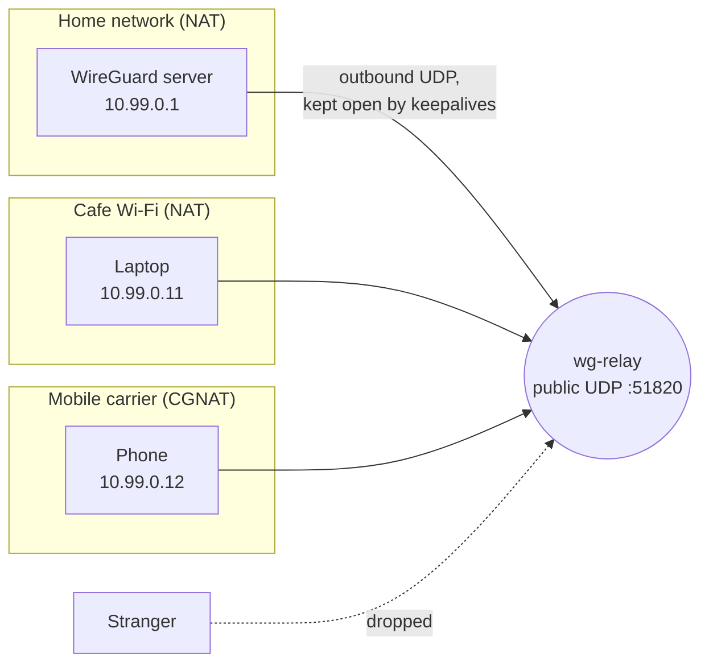

The relay's config file, `relay.toml`, lists the peers that others must be able to reach. These are usually the servers. This guide calls them **configured peers**. Every other peer is **unconfigured**: laptops and phones need no entry in the relay's config at all. They only need to be in the server's own WireGuard config, as they would be without a relay.

Three constraints shape the design.

| Constraint | Consequence |
|---|---|
| Peers run stock WireGuard: the kernel module, wireguard-go, the mobile apps | There is no custom protocol and no agent. The relay must work with the packets WireGuard already sends. |
| The relay must never be able to read traffic | It holds no keys of the peers and forwards datagrams unchanged. |
| The relay is on the public internet | It must not become a traffic reflector, and it must not let strangers in. |

## 2. The idea: route by two public fields

If the relay cannot decrypt anything, it needs another way to tell where a packet goes. WireGuard leaves two fields readable on purpose, and the relay routes by them.

**mac1, on handshake messages.** Every handshake message ends with a 16-byte MAC called mac1. Its key is a hash of the recipient's public key: `BLAKE2s("mac1----" ‖ recipient_public_key)`. WireGuard includes it so that a recipient can discard junk cheaply, before it does any expensive cryptography. It has a side effect: anyone who knows a public key can test whether a handshake message was addressed to that key. The relay knows the public keys of its configured peers, so it tests each one.

**Indexes, on everything.** Each side of a handshake picks a random 32-bit number, its **index**, and sends it as `sender_index`. Every later packet addressed to that side carries the same number as `receiver_index`. WireGuard uses it to find the right keys quickly. The relay watches handshakes go by, records which index belongs to which address, and routes every later packet by its `receiver_index`.

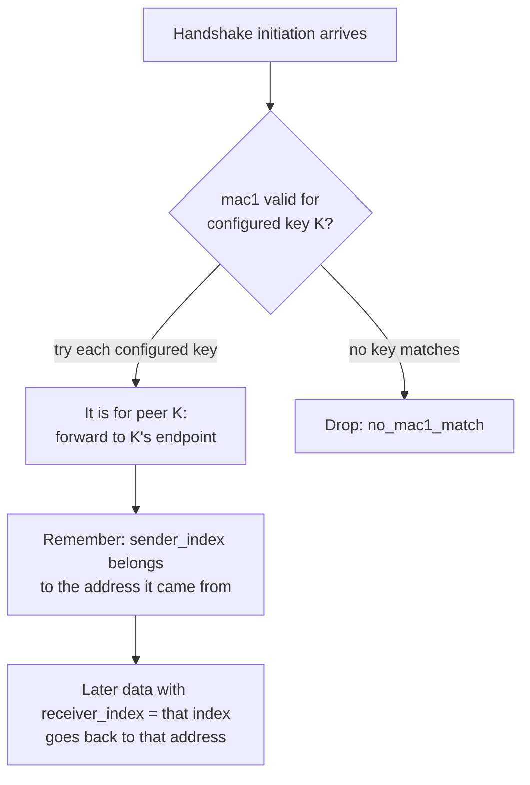

One property of mac1 explains several behaviours later in this guide. A MAC can be checked against a key you already have, but it cannot be reversed to reveal the key. The relay can therefore route a handshake only to a peer whose public key is in its config ([section 7](#7-who-can-reach-whom)).

## 3. WireGuard background

The relay decrypts nothing, but nearly every rule in it follows from something WireGuard does. This section covers the parts of the protocol that matter here. It follows the [WireGuard whitepaper](https://www.wireguard.com/papers/wireguard.pdf), which has the full details.

### 3.1 The four messages

WireGuard has exactly four message types. The fields in **bold** are the only ones the relay reads. Integers are little-endian.

| Type | Name | Size | Layout (bytes) |
|---|---|---|---|
| 1 | Handshake initiation | 148 | type(1) reserved(3) **sender_index(4)** ephemeral(32) enc_static(48) enc_timestamp(28) **mac1(16)** mac2(16) |
| 2 | Handshake response | 92 | type(1) reserved(3) **sender_index(4) receiver_index(4)** ephemeral(32) enc_empty(16) **mac1(16)** mac2(16) |
| 3 | Cookie reply | 64 | type(1) reserved(3) **receiver_index(4)** nonce(24) enc_cookie(32) |
| 4 | Transport data | 32 or more | type(1) reserved(3) **receiver_index(4)** counter(8) encrypted payload |

WireGuard has one fixed set of cryptographic primitives (Curve25519, ChaCha20-Poly1305, BLAKE2s) and negotiates nothing. There are no version or algorithm fields, so the three handshake-related messages have fixed sizes. The relay uses this: it rejects any message whose length does not fit its type.

mac1 covers every byte before it. That is the first 116 bytes of an initiation and the first 60 bytes of a response.

### 3.2 The handshake

Each peer has a long-term **static key pair**, which is its identity. The public half is what you write in a `PublicKey =` line. A handshake is one round trip that authenticates both peers and derives fresh encryption keys for a **session**. WireGuard uses the Noise protocol pattern `IKpsk2`: the initiator already knows the responder's static public key from its config, and sends its own static public key encrypted in the first message.

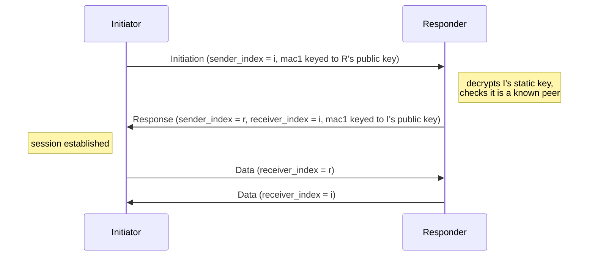

What an observer such as the relay can and cannot read in an initiation:

| Field | Contents | Who can read it |
|---|---|---|
| `sender_index` | the random index the initiator picked for this session | everyone. The relay routes on it. |
| `ephemeral` | the initiator's one-time public key | everyone, but it looks random |
| `enc_static` | the initiator's static public key, encrypted | only the responder |
| `enc_timestamp` | a timestamp, encrypted | only the responder |
| `mac1` | MAC keyed with a hash of the responder's public key | anyone who knows the responder's public key can verify it |
| `mac2` | zeros, or a MAC keyed with a cookie ([section 3.5](#35-cookies-wireguards-defence-under-load)) | the responder |

The response has the same shape. It carries the responder's own `sender_index`, echoes the initiator's index as `receiver_index`, and its mac1 is keyed with a hash of the initiator's public key.

Three properties of the handshake matter to the relay.

- **The initiation hides who is calling.** The relay cannot read `enc_static`. It can tell which configured peer an initiation is for, but not who sent it.
- **The responder refuses replays.** It remembers the newest timestamp it has seen from each peer and rejects any initiation that is not newer. A captured initiation cannot be replayed to start a session.
- **The initiator sends data first.** The responder may not send data until it has received a data packet from the initiator, because that packet confirms that both sides derived the same keys. An initiator with nothing to send therefore sends an empty packet, a keepalive, right after the handshake. The relay's registration depends on this packet ([section 4](#4-registration-how-the-relay-finds-a-server)).

### 3.3 Transport data

After the handshake, each side sends its traffic as transport data messages.

| Field | Bytes | Contents |
|---|---|---|
| `receiver_index` | 4 | the recipient's index, so that it finds the right keys without trying each one |
| `counter` | 8 | the nonce: 0, 1, 2 and so on per direction, sent in the clear |
| payload | 16 + n | the IP packet, padded to a multiple of 16 bytes and encrypted, with a 16-byte authentication tag |

- A **keepalive** is a data message with an empty payload. It is 4 + 4 + 8 + 16 = 32 bytes long, which is why 32 bytes is the smallest data message the relay accepts.
- The receiver tracks counters in a sliding window and drops duplicates, so replayed data is rejected.
- Padding hides exact packet lengths. An observer such as the relay sees sizes in 16-byte steps.

The relay uses `receiver_index` for the same purpose WireGuard does, a fast lookup. That is how it routes data without holding any keys.

### 3.4 Timers

WireGuard has no connection state to configure. A few fixed timers decide when handshakes happen.

| Constant | Value | Rule |
|---|---|---|
| `REKEY_AFTER_TIME` | 120 s | The side that initiated a session starts a new handshake once the session's keys are this old. |
| `REJECT_AFTER_TIME` | 180 s | Keys this old are never used again, in either direction. |
| `REKEY_TIMEOUT` | 5 s | An unanswered initiation is retried after this long, with a new `sender_index`. |
| `REKEY_ATTEMPT_TIME` | 90 s | Retries stop after this long, until there is new data to send. |
| `KEEPALIVE_TIMEOUT` | 10 s | A peer that received data and has nothing to send back for this long sends a keepalive. |
| no reply | 10 + 5 = 15 s | A peer that sent data and heard nothing for this long assumes the session is dead and starts a new handshake. |
| `PersistentKeepalive` | set per peer | Send a keepalive every N seconds regardless of traffic, to keep NAT mappings open. |

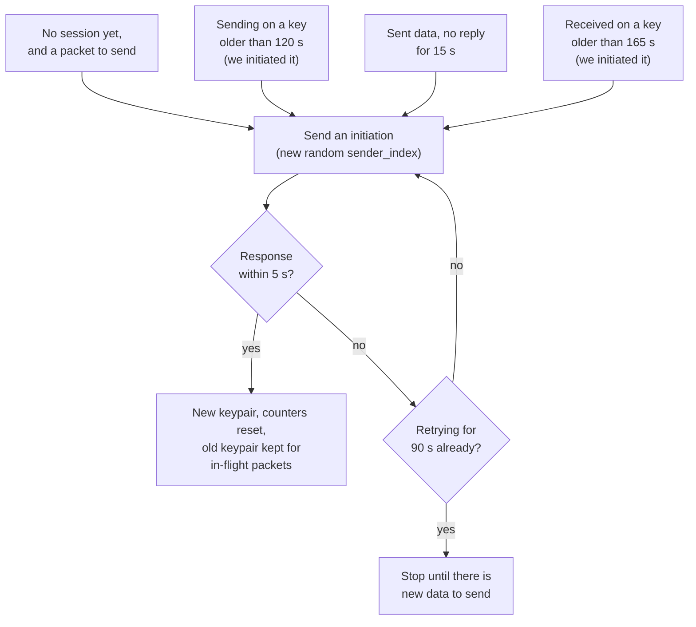

These numbers show up in the relay in four places.

- **Rekeying every two minutes** means that a long-lived connection is a chain of short sessions, each with new indexes. The relay keeps learning new indexes, and old ones can simply age out.
- **Keys die at 180 s.** The relay keeps each index for 200 s after its handshake and never extends that. It therefore never forgets an index that WireGuard might still use, and no index outlives its keys by more than 20 s.
- **The 15 s no-reply rule** is why a client that changes network recovers by itself within about 5 to 15 s ([section 13](#13-roaming-and-restarts)).
- **`PersistentKeepalive = 25`** keeps NAT mappings open and refreshes each configured peer's registration well inside its 180 s timeout.

### 3.5 Cookies: WireGuard's defence under load

Answering a handshake costs the responder several Curve25519 operations, so a flood of initiations could exhaust its CPU. mac1 already stops anyone who does not know the responder's public key. Against floods from senders who do know it, WireGuard has a second mechanism. A responder under load does not process the handshake. It answers with a **cookie reply** instead, and the initiator must send its initiation again with a second MAC, mac2, computed from that cookie. The cookie is derived from the sender's IP address and port, so a valid mac2 proves that the sender can receive packets at the address it claims.

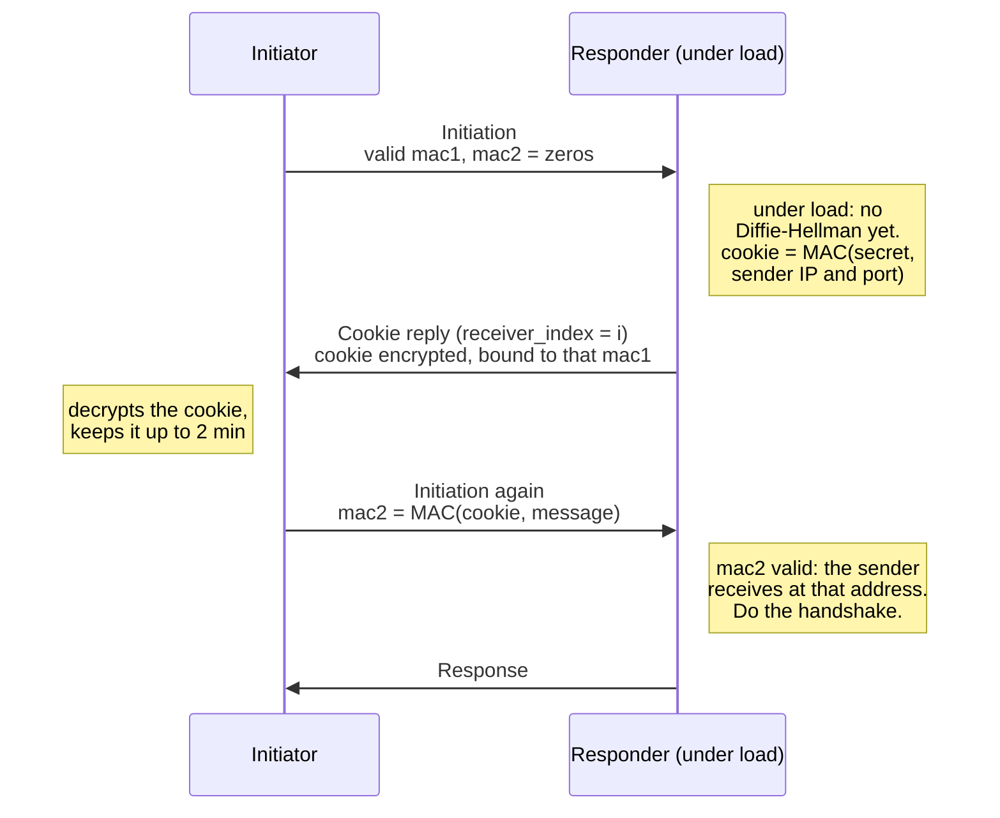

This has two consequences for the relay.

**The relay must pass cookie replies before a session is established.** A cookie reply answers an initiation, so it arrives while the relay is still waiting for the handshake response. If the relay dropped it, a server under load could never complete a handshake through the relay ([section 6](#6-sessions)).

**The relay weakens this defence.** The server sees every packet arrive from the relay's address, so it computes the same cookie for every client. The cookie no longer proves anything about the real sender. Someone who obtains one cookie through the relay could attach a valid mac2 to initiations sent from many spoofed addresses, and the server would do the expensive work for each. The relay's own limits are then the only brake: a rate limit per source address and a budget on the work it spends routing handshakes ([section 9.5](#95-what-a-handshake-costs-the-relay)). Each spoofed source gets its own rate allowance, so the protection is weaker than WireGuard's own. Two hardening options exist and are not implemented: a cap on initiations per server, or having the relay run the cookie exchange itself, which needs only the server's public key.

### 3.6 AllowedIPs and roaming

Each peer entry in a WireGuard config has an `AllowedIPs` list. It does two jobs.

- **Sending.** The destination IP of an outgoing packet selects the peer whose `AllowedIPs` contain it. The packet is encrypted for that peer and sent to that peer's endpoint.
- **Receiving.** A decrypted packet is accepted only if its inner source IP is in the `AllowedIPs` of the peer whose keys decrypted it. A peer cannot spoof another peer's tunnel address.

WireGuard also updates a peer's endpoint to the source address of every authenticated packet it receives from that peer. This is called **roaming**: peers can change address freely, and the most recent address wins.

Behind the relay, both features behave in a specific way.

- Every peer's endpoint is the relay, and it never changes. From WireGuard's point of view nothing roams. The relay has to handle address changes itself ([section 13](#13-roaming-and-restarts)).
- A configured peer's entry for the relay has `AllowedIPs = 10.99.0.254/32`, the relay's own tunnel address. Even an attacker who holds the relay's private key can only inject packets whose inner source is that one address. The relay's key gives access to one `/32` and nothing else.

### 3.7 What the relay preserves and what it weakens

| Property | How WireGuard provides it | Through wg-relay |
|---|---|---|
| Confidentiality and integrity | authenticated encryption on every packet | Unchanged. The relay cannot read or alter anything. |
| Mutual authentication | static keys in the handshake | Unchanged. The relay never holds a peer's private key. |
| Forward secrecy | one-time keys, replaced every 2 minutes | Unchanged. |
| Replay protection | handshake timestamps, data counters | Unchanged. |
| Silence towards strangers | no reply without a valid mac1 and handshake | Kept. The relay never answers forwarded traffic itself. |
| Identity hiding | the initiator's static key is encrypted | Partly lost. mac1 tells the relay which configured peer is being called. The caller stays hidden. |
| Flood resistance | mac1, and cookies bound to the sender's address | Weakened. The server sees one address, so cookies stop telling clients apart ([section 3.5](#35-cookies-wireguards-defence-under-load)). |
| Hidden packet sizes | padding to 16 bytes | Unchanged. The relay sees padded sizes and timing. |

## 4. Registration: how the relay finds a server

To forward a handshake to a server behind NAT, the relay needs the public address and port that the server's NAT currently assigns to it. Nobody can configure that in advance, because the NAT picks it and may change it. The server has to tell the relay, and it has to prove that it is the real server. Otherwise anyone could claim to be the server and capture or discard its incoming connections.

wg-relay solves both with WireGuard itself. The relay has its own key pair and is an ordinary WireGuard peer of each configured peer. The tunnel between them is the **registration tunnel**. It carries no user traffic. Its only purpose is that each authenticated packet on it proves where the configured peer is at that moment. The relay records that address in its **registry** as the peer's **endpoint**.


The rules of registration:

- **Only authenticated packets count.** A data packet or keepalive that decrypts on a peer's registration tunnel registers that peer at the packet's source address. So does a valid handshake response to an initiation that the relay's side of the tunnel sent. An initiation alone does not, because a captured initiation could be replayed from another address. A cookie reply never counts.
- **The keepalive does two jobs.** `PersistentKeepalive = 25` on the server refreshes the registration and keeps the server's NAT mapping open, so that forwarded handshakes can get in.
- **A registration expires.** The relay forgets a configured peer after 180 s without an authenticated packet. Handshakes for it are then dropped (`peer_not_registered`) instead of being sent to an address that may now belong to someone else.
- **A registration follows the peer.** If an authenticated packet arrives from a new address, the registry moves the peer there, and the relay rewrites every session that used the old address.
- **Only configured keys can register.** A registration attempt from any other key is dropped (`registration_unknown_key`). Unconfigured peers never talk to the relay itself.

The relay answers pings to its tunnel address, so `ping 10.99.0.254` from a configured peer is a quick registration check.

Any peer can be configured, not only servers. A laptop that others should be able to call registers in the same way.

## 5. A client connects

The client is unconfigured. Its WireGuard config lists the server as a peer with `Endpoint = relay:51820`, and nothing else about it is special. The diagram shows a full connection and what the relay records at each step. `C` is the public address the client's NAT gives it. The server is registered at address `S`.

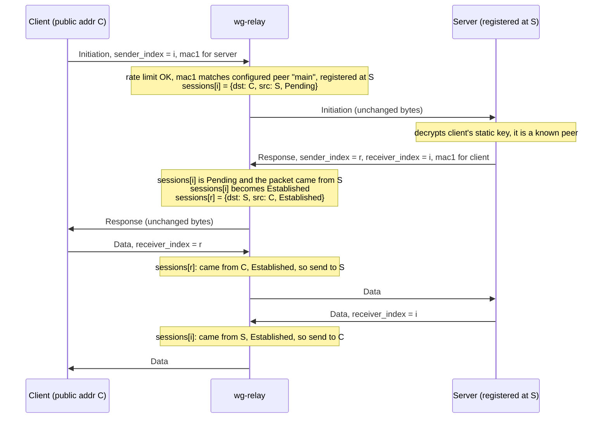

Step by step:

1. **The initiation arrives.** The relay finds the configured peer whose key matches mac1 and looks up its endpoint `S`. It records a routing entry for the client's index `i`: packets carrying `receiver_index = i` go to `C` and must come from `S`. The entry is **pending**. The relay forwards the initiation to `S`.
2. **The response arrives.** It carries `receiver_index = i`. The relay checks that the entry for `i` is pending and that the response came from `S`. It then marks the entry **established** and adds a second entry for the server's index `r`: packets for `r` go to `S` and must come from `C`. It forwards the response to `C`.
3. **Data flows.** Each data packet is looked up by its `receiver_index`, checked against the expected source, and forwarded.

This guide calls such a routing entry a **session**. Note the difference from WireGuard's use of the word: one WireGuard session produces two relay sessions, one per direction.

Each session records two addresses: where packets with that index go (`dst`), and the only address allowed to send them (`src`). The `src` check is what stops a third party from injecting packets into a session, even if it guesses the index. It also means that only the configured peer itself can complete a handshake, because the pending entry expects the response from `S`.

## 6. Sessions

### States

A session is in one of two states.

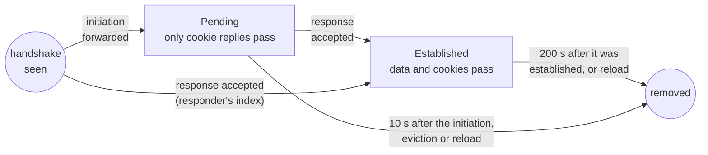

The state decides which messages may pass. In every case the message must also come from the session's `src`.

| Message addressed to the index | Pending | Established |
|---|---|---|
| Handshake response | accepted, once ([section 9.4](#94-accepting-a-response)) | dropped (`session_not_pending`): one response per initiation |
| Cookie reply | forwarded, so that a server under load can answer | forwarded |
| Transport data | dropped (`unknown_index`) | forwarded |

### Lifetimes

Lifetimes are fixed and traffic never extends them.

- An **established** session is removed 200 s after its handshake was accepted, however much traffic it carries.
- A **pending** session is removed 10 s after its initiation, however many cookie replies pass through it.

This is safe because of WireGuard's own timers. A connection in use rekeys every 2 minutes, which creates new indexes and new sessions, and WireGuard never uses keys older than 180 s. By the time a session is removed, its traffic moved to newer sessions long ago.

Fixed lifetimes have two benefits. Forwarding only reads the session table, which is what allows several threads to forward without a lock ([section 8](#8-inside-the-relay)). And nobody can keep a session alive by sending traffic: a client that a server has removed from its WireGuard config cannot make the relay keep forwarding junk to the server beyond the lifetime of its last accepted handshake.

### Quotas

Quotas keep the table bounded and stop one peer's problem from affecting others.

| Limit | Value | When it is reached |
|---|---|---|
| Pending sessions per configured peer | 1,024 | A new initiation evicts that peer's oldest pending session (counted as `pending_evicted`). |
| Sessions per configured peer, pending and established | 65,536 | New initiations to the peer and responses from it are dropped (`peer_quota`) until entries expire. |
| Pending sessions in total | 262,144 | New initiations are dropped (`too_many_pending`). |
| Sessions in total | 917,504 | New sessions are refused (`too_many_sessions`). |

- The **per-peer pending quota** means that a flood of initiations aimed at one server only competes with real handshakes to that server. A real handshake survives as long as the server answers it before 1,024 newer initiations for the same server arrive.
- The **per-peer session quota** leaves room for about 16,000 busy connections per configured peer. A busy connection holds four entries: the current pair and, until it expires, the previous pair. The quota also contains a misbehaving configured peer: one that answers spoofed initiations with made-up responses can only fill its own share.
- The **total pending limit** leaves most of the table for established sessions. With the default budgets, a flood cannot create pending sessions fast enough to reach it.
- The **total limit** bounds memory at about 240 MB ([reference](reference.md#session-table)). After a flood, garbage collection gives the memory back.

### Index collisions

Indexes are random, so two handshakes can pick the same one, with probability 2⁻³² per pair. The relay never lets a handshake take over an index that is in use.

- A handshake whose index is held by a live session of a different address pair is dropped (`index_in_use`). The peer retries with a new index.
- A live established session is never replaced, even by the same address pair. An initiation that is sent again or replayed with an established session's index is dropped (`index_in_use`). It can neither interrupt the session nor restart its lifetime.

WireGuard uses a new index for every initiation, so real peers do not run into either rule.

## 7. Who can reach whom

### Who can start a handshake

mac1 on an initiation is keyed to the responder's public key. The relay can therefore route an initiation only to a peer whose key it has, which means a configured peer that is currently registered. Who sent the initiation does not matter.

| Initiator → responder | Through the relay |
|---|---|
| unconfigured → configured (a laptop calls the server) | Works. This is the normal case. |
| configured → configured (two servers, or a server and a configured laptop) | Works in both directions. |
| configured → unconfigured (the server calls a laptop) | Dropped (`no_mac1_match`): no configured key matches. |
| unconfigured → unconfigured | Dropped (`no_mac1_match`). |

Configured peers form a full mesh: each can start a handshake with any other. Here a server calls a laptop that is also configured and registered at `L`.

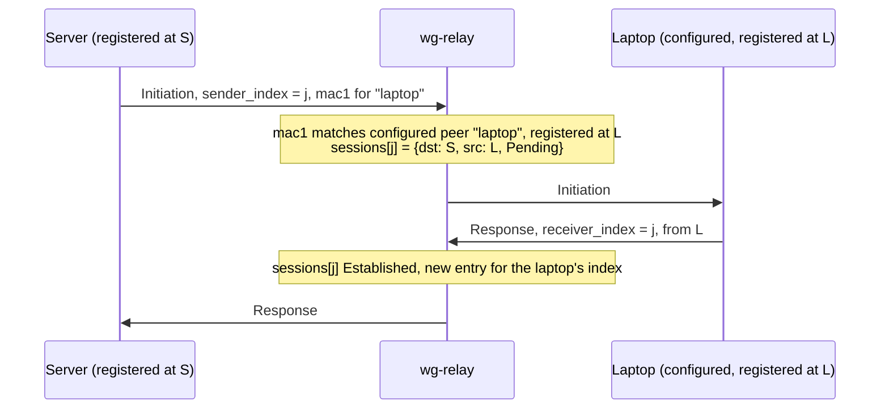

The gap is a server calling an unconfigured laptop. It rarely matters in practice. The laptop starts the first handshake, and in WireGuard the side that started a session also starts its rekeys ([section 3.4](#34-timers)). With `PersistentKeepalive` set, the laptop keeps the connection alive by itself. The gap shows mainly after the server restarts: the server cannot call the laptop, and the connection resumes when the laptop next sends something. A peer that must always be reachable can be added to `relay.toml`.

### Access control

The relay has one rule: **a session is established only when a configured peer answers from its registered endpoint.**

Anyone may send an initiation to a registered configured peer, subject to the rate limit. The relay forwards it. The configured peer's own WireGuard then decides whether it knows the sender. If it does not, it stays silent, and the pending session expires after 10 s. A stranger's initiation reaches the server and is dropped there.

Two lists therefore decide access.

| List | Decides |
|---|---|
| `relay.toml` | which peers can register, and so be reached through the relay |
| each configured peer's WireGuard config | who may talk to that peer. This is the only authentication of clients. |

To revoke a configured peer, remove it from `relay.toml` and send SIGHUP. Its registration and every session routed to it are removed at once. To revoke an unconfigured peer, remove it from the WireGuard configs of the configured peers it talks to.

The relay does not limit how many unconfigured peers a configured peer accepts. It cannot cap who uses its bandwidth beyond the handshake rate limit.

## 8. Inside the relay

### 8.1 A pure state machine

The core of the relay is the `Relay` type in `src/relay/mod.rs`. Its main method, `Relay::handle(src, datagram, now)`, performs no I/O. It takes one received datagram and returns a **verdict**: forward it to an address, drop it for a named reason, or report that the relay consumed it itself. A socket loop in `src/app/forwarding.rs` reads datagrams, calls `handle`, and acts on the verdict. This separation is what lets the tests run complete handshakes through the relay in memory.

The socket loop works in batches. One `recvmmsg` call returns up to 32 buffers, and with UDP GRO (generic receive offload) each buffer can hold up to 64 datagrams from one source. Each datagram goes through `handle` separately. Consecutive datagrams that are forwarded to the same address then leave in one UDP GSO (generic segmentation offload) send, which the kernel splits back into the original datagrams. Without GRO and GSO the same loop handles one datagram at a time. The [reference](reference.md#socket-io) has the details.

### 8.2 Two planes

Almost all traffic is transport data on established sessions. Forwarding it needs one lookup and changes nothing. Handshakes are rare, but they need more state and they change it. The relay is split along that line.

- The **data plane** (`DataPlane`, `src/relay/data_plane.rs`) handles the common case. It holds the established sessions, each with its destination, expected source and the time it was established. It also holds the reserved index prefixes of the registration tunnels ([section 10](#10-the-index-space)). It only reads this state.
- The **control plane** (`ControlPlane`, `src/relay/control_plane/`) owns everything else: the configured peers and their registration tunnels, the registry, the rate limiter, the work budgets, and the full session table including pending sessions and quotas. It is the only writer of the data plane's state.

For each datagram, the data plane makes one of three decisions:

- **Forward** it, if it is transport data or a cookie reply on an established session and comes from that session's expected source.
- **Drop** it, if the data plane can tell by itself that it is invalid. The reasons are `invalid_source`, `malformed`, `wrong_source` and `unknown_index`.
- **Hand it to the control plane**, for everything else: handshake messages, messages for a registration tunnel, and cookie replies that are not on an established session.

Two details keep the planes consistent.

- **The session table updates the data plane itself.** Every operation that establishes, moves or removes an established session makes the same change in the data plane's copy, in the same call. The two cannot disagree.
- **A response's sessions are published before the response is forwarded.** The initiator's first data packet can therefore never arrive before the data plane knows its session. This matters because the data plane drops data on unknown indexes instead of handing it over.

### 8.3 Threads

The relay runs several identical **forwarding threads**, set by `workers` in `relay.toml` and defaulting to one per CPU. Each has its own UDP socket. All sockets are bound to the listen address with `SO_REUSEPORT`, so the kernel picks a socket for each incoming datagram by hashing its source and destination addresses. One flow always lands on the same thread and stays in order. Different flows spread across the threads.

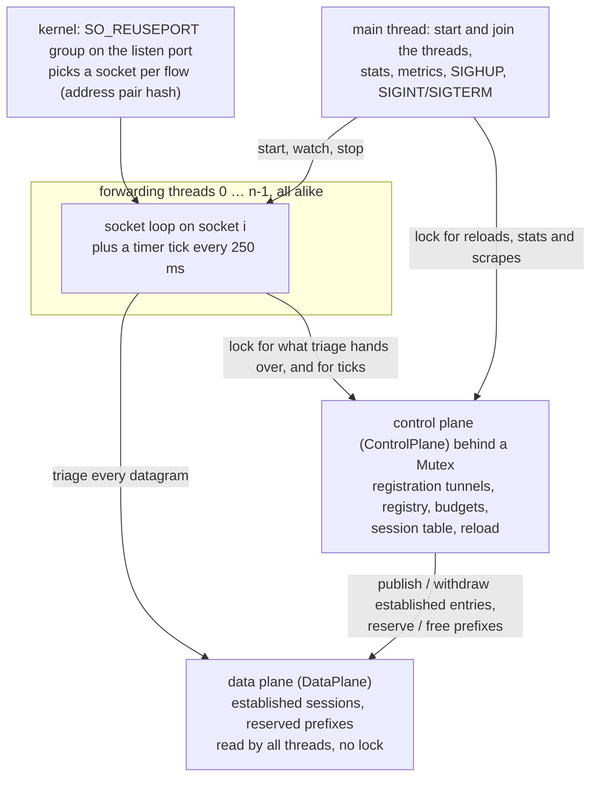

How the threads share state:

- **The data plane is shared without a lock.** Its two maps are concurrent hash maps (the `papaya` crate). Every thread reads them at once, while the control plane writes.
- **The control plane is behind one mutex.** A thread locks it for each datagram the data plane hands over, decides the datagram, and unlocks. It then sends the result on its own socket. All sockets have the same address, so it does not matter which one sends.
- **Counters are per thread.** Each thread counts what it decides, so counting never causes contention.
- **Timers are driven by the threads.** Every thread offers the control plane a timer tick every 250 ms. The control plane accepts at most one tick per 250 ms, however many threads offer one.

The main thread forwards nothing. It starts the forwarding threads, logs statistics every 60 s, serves the Prometheus endpoint if it is enabled, handles signals, and stops the threads at shutdown.

One consequence of reading without a lock: a thread that is in the middle of a batch may forward a few more datagrams on a session that the control plane has just removed or moved. Its next lookup sees the change.

### 8.4 State tables

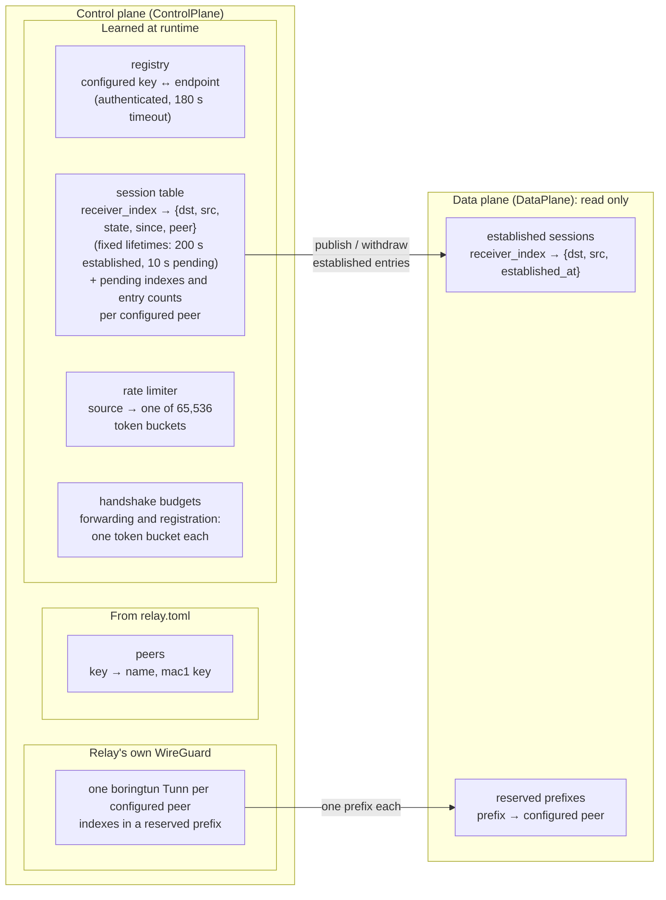

| Table | Plane | Written when | Expires |
|---|---|---|---|
| Registry | control | a packet authenticates on a configured peer's registration tunnel | after 180 s without an authenticated packet |
| Session table | control | a handshake is forwarded (pending) or accepted (established). Forwarded data never writes it. | 200 s after the handshake was accepted, or 10 s after the initiation while pending |
| Established sessions | data | by the session table, together with its own change | with the session table entry. A lookup also checks the 200 s lifetime itself, so an entry stops forwarding on time even before garbage collection removes it. |
| Reserved prefixes | data | by the control plane, when a registration tunnel is created at startup or reload | when its configured peer is removed |
| Rate limiter | control | every initiation | never. It is a fixed array of buckets, so its memory is constant. |
| Work budgets | control | every handshake that costs work | never. They refill continuously. |

The principle behind all of this state: the relay never sends to an address it has not either authenticated (a configured peer's endpoint) or seen as the source of a handshake it forwarded (everyone else).

## 9. The path of a datagram

Every datagram goes through `Relay::handle`. Two decisions settle what happens to it, and each is made in one place. The checks run from cheapest to most expensive, so junk is rejected before any cryptography.

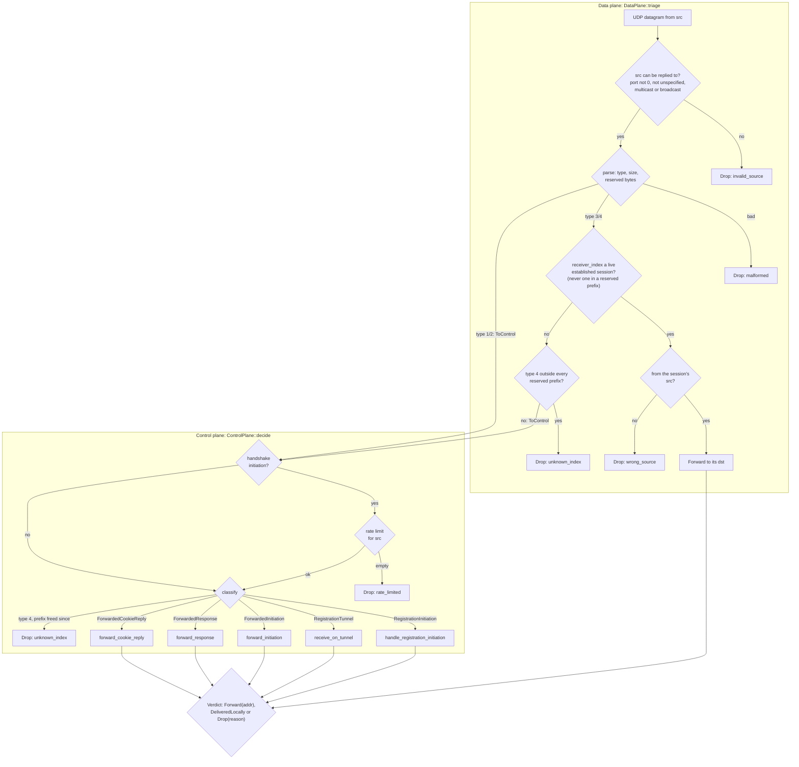

### 9.1 Triage in the data plane

`DataPlane::triage` runs on every datagram, on every thread, without a lock. It answers `Forward(dst)`, `Drop(reason)` or `ToControl(message)`.

1. **Check the source address.** A datagram from port 0 or from an unspecified, multicast or broadcast address is dropped (`invalid_source`). Nobody could be answered at such an address, so it must never be stored as a session's destination.
2. **Parse the header.** Only the type, the length and the indexes are read. Anything that does not fit is dropped (`malformed`).
3. **Look up an established session.** For transport data and cookie replies, the relay looks up `receiver_index`. If a live established session exists, the datagram is forwarded when it comes from the session's `src`, and dropped (`wrong_source`) otherwise.
4. **Drop junk data.** Transport data that is on no established session is junk, unless its index belongs to a registration tunnel. The data plane drops it (`unknown_index`). A flood of data with made-up indexes therefore never touches the control plane's lock.
5. **Hand over the rest.** Everything else needs state that only the control plane has.

### 9.2 Classes in the control plane

`ControlPlane::decide` runs under the lock. It first applies the rate limit per source to every handshake initiation, before any hashing. Then a function named `classify` assigns the datagram to one of five classes without changing any state, and a single `match` calls the handler for that class.

| Class | Which datagrams | What the handler does |
|---|---|---|
| `RegistrationInitiation` | an initiation whose mac1 is keyed to the relay's own key | identifies the sender and passes the message to that peer's registration tunnel ([section 4](#4-registration-how-the-relay-finds-a-server)) |
| `RegistrationTunnel` | any other message whose `receiver_index` belongs to a registration tunnel | passes it to that tunnel, which decrypts it |
| `ForwardedInitiation` | any other initiation | finds the configured peer and creates a pending session ([section 9.3](#93-forwarding-an-initiation)) |
| `ForwardedResponse` | any other response | completes the pending session ([section 9.4](#94-accepting-a-response)) |
| `ForwardedCookieReply` | any other cookie reply | forwards it on a pending or established session |

One rare case has no class. The data plane hands over transport data only when its index is in a reserved prefix. If a reload removes that prefix before the control plane takes the lock, `classify` finds nothing for the datagram and drops it (`unknown_index`).

Each handler returns either what it accepted or a drop reason. One function, `record_verdict`, turns that into the final verdict, counts it in the counters of the plane that decided, and logs drops at debug level with their reason.

### 9.3 Forwarding an initiation

`forward_initiation` applies these checks in order. Each failed check drops the initiation with the reason shown.

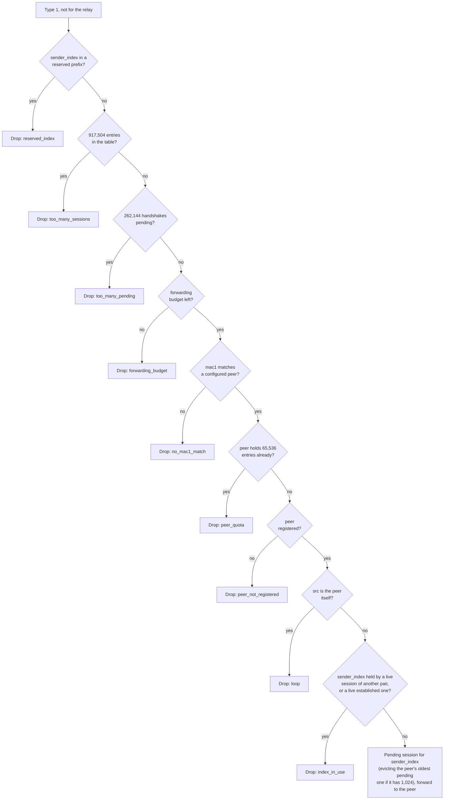

The cheap table checks come first. The mac1 scan, which costs hashing, happens only when there is room for a new session and work budget left.

### 9.4 Accepting a response

`forward_response` makes sure that a response really is the configured peer's answer to a pending initiation, and that it is accepted only once.

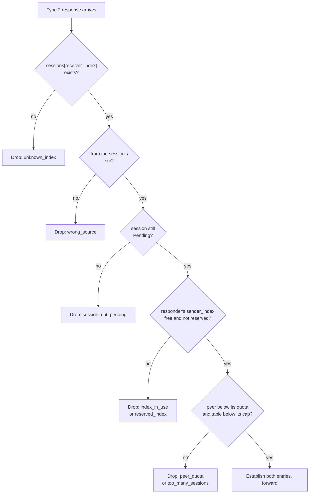

### 9.5 What a handshake costs the relay

Initiations are the only packets that cost the relay real CPU before anyone is authenticated. There are two kinds of work.

- **Routing a forwarded initiation** means hashing its mac1 against the configured keys until one matches. The relay checks eight keys at a time with SIMD.
- **A registration attempt** costs one X25519 operation, about as much as 400 key checks.

The relay limits this work in three layers.

1. **A rate limit per source.** Each source, meaning one IPv4 address or one IPv6 /64, may send `handshake_rate_per_ip` initiations per second. This is checked first, before any hashing.
2. **A forwarding budget.** The mac1 scans may spend 1,000,000 key checks per second in total.
3. **A registration budget.** Registration attempts from addresses that are not a configured peer's current endpoint may spend the equivalent of 200,000 key checks per second, which is 500 attempts.

The two budgets are separate token buckets, so a flood on one path cannot starve the other. Telling the two paths apart costs one mac1 check against the relay's own key. A registration initiation from a configured peer's current endpoint skips the registration budget, so a flood of registration attempts from elsewhere cannot stop registered peers from renewing their tunnels.

While a budget is empty, initiations on that path are dropped after at most one hash. A flood from many sources then costs little, and established sessions are unaffected. Real handshakes on the flooded path still compete with the flood. Junk initiations can delay forwarded handshakes, and a registration flood can delay peers that register from a new address.

## 10. The index space

The registration tunnels are WireGuard tunnels too, so they have indexes of their own. Those indexes appear in the same `receiver_index` field as the indexes of forwarded traffic. If a forwarded session ever used an index that a registration tunnel owns, the relay would take that session's packets for itself. The index space is therefore split.

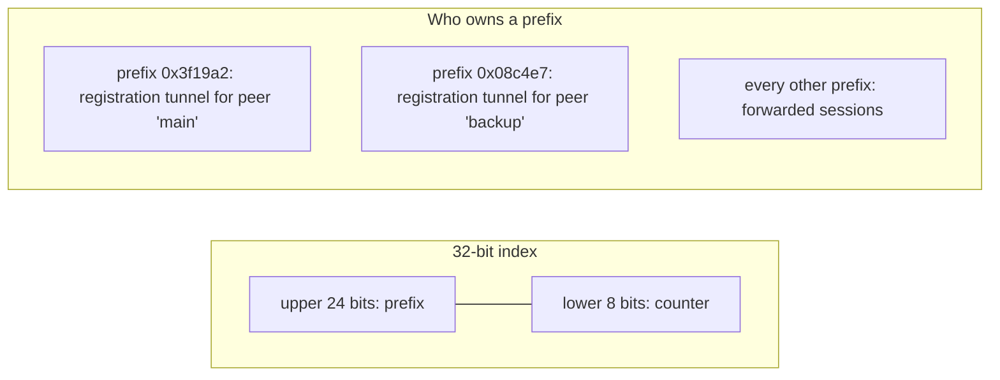

- The relay's WireGuard library, boringtun, numbers a tunnel's indexes as `prefix << 8 | counter`. Each registration tunnel therefore uses at most 256 indexes, all under one 24-bit prefix.
- Each registration tunnel gets a random prefix that no live forwarded session uses at the time. That prefix is **reserved**.
- A forwarded handshake whose `sender_index` falls in a reserved prefix is dropped (`reserved_index`). WireGuard retries with a new random index.

The two kinds of index can therefore never collide. A message whose `receiver_index` is in a reserved prefix belongs to that registration tunnel, and no established session is ever in a reserved prefix. The data plane relies on the second fact: it looks up established sessions first and consults the reserved prefixes only on a miss, so forwarded traffic never pays for the second lookup.

## 11. Timers and limits

| What | Value | Constant or setting | Purpose |
|---|---|---|---|
| Peer keepalive | 25 s | `PersistentKeepalive` in the peers' configs | keeps NAT mappings open and refreshes registrations |
| WireGuard rekey | about 2 min | WireGuard itself | new keys and new indexes |
| Registration timeout | 180 s | `REGISTRATION_TIMEOUT` | a configured peer that is silent this long is forgotten |
| Established lifetime | 200 s from the handshake | `ESTABLISHED_TIMEOUT` | indexes of old handshakes age out |
| Pending lifetime | 10 s from the initiation | `PENDING_TIMEOUT` | unanswered initiations do not pile up |
| Relay tick | 250 ms | `TICK_INTERVAL` | runs the registration tunnels' timers |
| Garbage collection | 1 s | `GC_INTERVAL` | removes expired entries and shrinks tables that are mostly empty |
| Thread check | 250 ms | main thread | notices a forwarding thread that stopped |
| Stats log | 60 s | main thread | logs all counters, with drops by reason |
| Rate limit | `handshake_rate_per_ip`, burst of 2 s worth | `relay.toml` | caps initiations per source |
| Forwarding budget | 1,000,000 key checks/s, burst of 1 s | `FORWARDING_WORK_PER_SEC` | caps the CPU spent routing forwarded handshakes |
| Registration budget | 200,000 key checks/s (500 attempts), burst of 1 s | `REGISTRATION_WORK_PER_SEC` | caps X25519 work for registration attempts from unregistered addresses |
| Pending quota | 1,024 per configured peer, 262,144 in total | `MAX_PENDING_PER_PEER`, `MAX_PENDING` | contains initiation floods |
| Session quota | 65,536 per configured peer, 917,504 in total | `MAX_SESSIONS_PER_PEER`, `MAX_SESSIONS` | bounds memory, and one peer's share of it |

The values are chosen to nest. A healthy configured peer refreshes its registration about seven times within the 180 s timeout. A connection in use rekeys every 2 minutes, so its old sessions are idle well before they expire at 200 s.

```mermaid
gantt
    title One server and one client over five minutes (relative seconds)
    dateFormat X
    axisFormat %s
    section Server
    registered, keepalive every 25 s     :0, 300
    section Session 1
    traffic                              :done, 0, 120
    replaced, expires at 200 s           :120, 200
    section Session 2
    traffic                              :done, 120, 240
    replaced, expires at 320 s           :240, 300
    section Session 3
    traffic                              :done, 240, 300
```

## 12. Reload

`kill -HUP` makes the relay read `relay.toml` again.

- If the file is invalid, the running config stays in effect and an error is logged.
- Changes to `listen`, `workers`, `private_key` and `metrics_listen` need a restart.
- Everything else applies at once: the peers, `tunnel_ip`, `handshake_rate_per_ip` and `public_endpoint`.
- If the change alters the `[Peer]` section that configured peers paste into their WireGuard config, the relay prints the section again.

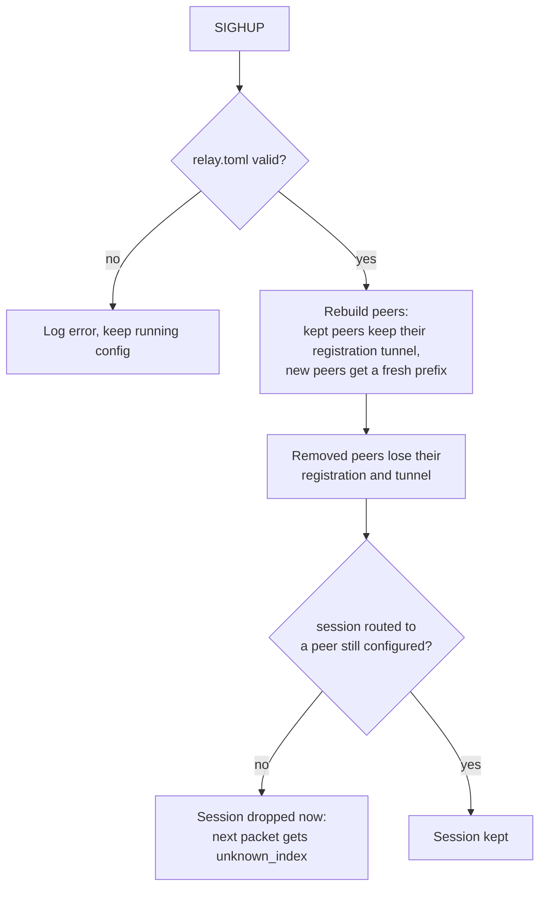

Removing a peer revokes it immediately, not at the next rekey. Each session records the configured peer it was routed to. When that peer is removed, its sessions are removed with it, and the next packet in either direction is dropped. Sessions of peers that stay configured are untouched.

## 13. Roaming and restarts

WireGuard normally follows a peer that changes address ([section 3.6](#36-allowedips-and-roaming)). Behind the relay, every peer only ever sees the relay's address, so the relay has to deal with address changes. What it can do depends on whether the peer authenticates to it.

**A configured peer changes address.** This happens when its NAT assigns a new mapping, or when it moves to another network. Its next keepalive on the registration tunnel authenticates from the new address. The relay moves the registration and rewrites every session that used the old address. Until that keepalive arrives, which takes at most 25 s, traffic in both directions is lost.

**An unconfigured peer changes address.** Its packets now come from an address that no session expects, so the relay drops them (`wrong_source`). WireGuard on the client notices that no replies arrive and starts a new handshake, which works normally.

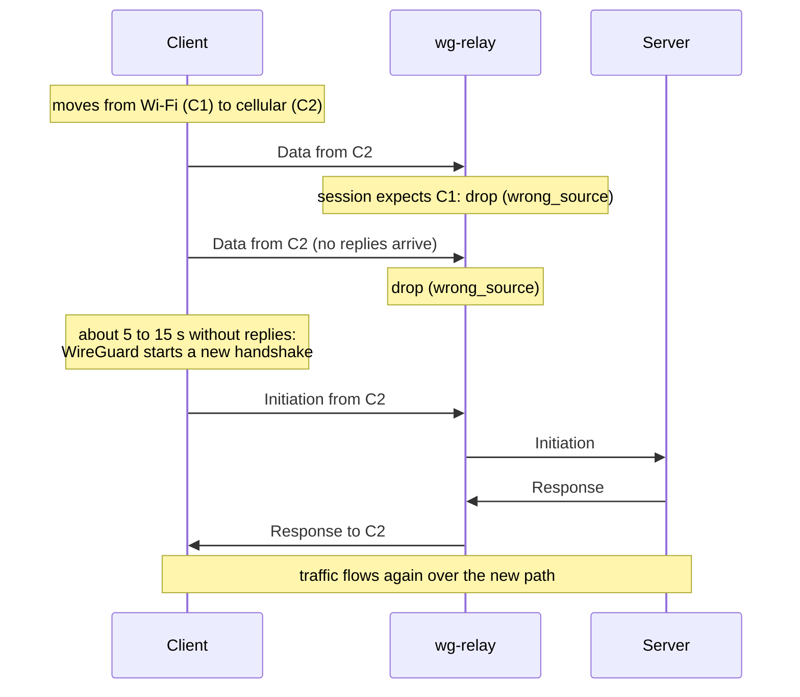

The relay cannot follow the client any sooner. An unconfigured peer never authenticates to the relay, and accepting a new address on the packet's word would let anyone hijack a session.

**The server restarts.** It registers again within seconds, because its first packet to the relay is a handshake. Its sessions with clients are gone on the server's side. A client's next data gets no reply, and the client starts a new handshake as above. The server itself can start handshakes only towards configured peers ([section 7](#7-who-can-reach-whom)).

**The relay restarts.** All registrations and sessions are lost. Configured peers register again with their next handshake to the relay, and clients start new handshakes once their data goes unanswered.

## 14. Security model

### What the relay can see

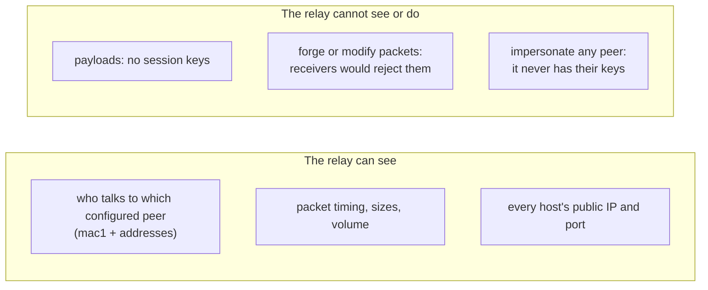

A compromised relay is in the position of an attacker on the network path. It can observe metadata and drop traffic. It cannot read traffic, change it, or pose as a peer.

### Threats and defences

| Threat | Defence |
|---|---|
| Using the relay as a reflector or amplifier | The relay sends only to a configured peer's endpoint or to an address that sent a handshake it forwarded. It never sends more than it received, and forwarded traffic never makes the relay generate a reply. |
| Strangers reaching a configured peer | The peer's own WireGuard peer list rejects them. |
| Injecting packets into someone's session | Every non-handshake packet must come from the session's `src`. |
| Redirecting a configured peer's traffic | Registration needs a full WireGuard handshake with that peer's key, and replays fail WireGuard's timestamp and counter checks. |
| Handshake floods | A rate limit per source, then separate work budgets for forwarding and registration, all checked before any expensive work ([section 9.5](#95-what-a-handshake-costs-the-relay)). |
| Crowding out real handshakes to a server | Each configured peer has its own quota of 1,024 pending sessions and evicts its oldest first. A flood aimed at one peer does not affect the others. |
| A configured peer filling the table by answering spoofed initiations | Each configured peer may hold at most 65,536 sessions, so it can only deny service to itself. |
| Exhausting memory | The rate limiter is a fixed array. The session table is capped at 917,504 entries, about 240 MB. Tables shrink after a flood. |
| Flooding junk data with made-up indexes | The data plane drops it after one or two hash lookups, on every thread at once, without the control plane's lock. |
| Keeping a session alive with junk | Lifetimes are fixed from the handshake. Neither data nor cookie replies extend them, and sending an initiation again cannot reset an established session. |
| Sources that cannot receive replies | Datagrams from port 0 and from unspecified, multicast or broadcast addresses are dropped first (`invalid_source`). |
| A removed configured peer lingering | SIGHUP removes its registration and sessions immediately. |
| Unapproved peers using the relay's bandwidth | Not prevented. A configured peer can accept any number of unconfigured peers, and only handshakes are rate limited. |

### Known residual risks

The [reference](reference.md#limitations) lists these with their reasoning. The two most important:

- **A flood from very many sources can block handshakes.** A flood spread over all 65,536 rate-limit buckets, at about 65,536 × `handshake_rate_per_ip` initiations per second, empties every bucket, including those of registered peers. New handshakes are blocked until the flood ends. Established sessions continue until they need to rekey.
- **A configured peer's endpoint is trusted by address alone.** On the forwarding path, the source address and port are the only check that a response comes from a configured peer. An attacker who can spoof packets from that exact endpoint can establish sessions for pending initiations. The quotas bound the memory this takes, but it can deny service to that one peer.

### What the relay's private key is worth

The relay's key opens only the registration tunnels, which carry keepalives and pings to one `/32` address. An attacker who steals it could pose as the relay towards the configured peers. That gives the attacker the position of an on-path observer: able to drop or misroute traffic, not to read it.

## 15. Code map

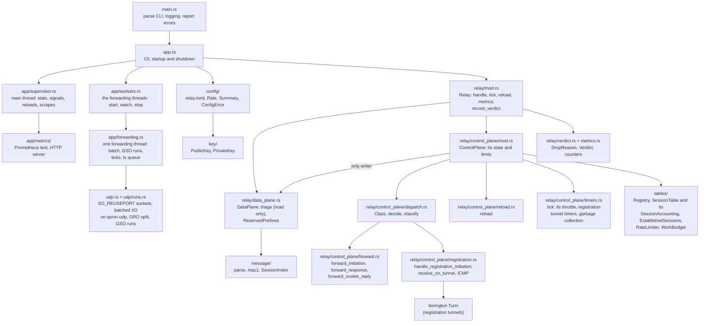

To see how the pieces fit, follow one transport data message through the code.

1. **Receive.** `Batch::forward()` in `app/forwarding.rs` receives a batch with `Socket::try_recv` (`recvmmsg`, in `udp.rs`). The message is either alone in a buffer or one segment of a GRO buffer, which `udp::runs::segments()` splits. The loop calls `relay.handle(src, bytes, now)`.
2. **Parse.** `DataPlane::triage()` checks the source address and calls `message::parse()`, which returns `Message::TransportData { receiver_index }`.
3. **Look up.** `established.get(receiver_index, now)` finds the live established session, without a lock. Nothing is written.
4. **Decide.** The source matches the session's `src`, so `triage()` returns `Triage::Forward(dst)`. `record_verdict()` counts it in this thread's counters.
5. **Send.** `Plan::make()` in `udp/runs.rs` groups the message with neighbouring datagrams for the same address. `Worker::send_run()` sends the group as one GSO send of the original bytes. If the GSO send fails, the datagrams are sent one by one.

## 16. How it is tested

| Layer | Where | What it covers |
|---|---|---|
| Unit | `#[cfg(test)]` modules in `src/` | each table and each plane in isolation (details below) |
| Message | `tests/message.rs` | parsing, size checks and mac1 matching on real messages made by boringtun |
| Config | `tests/config.rs` | defaults, the exact error for each bad input, `--check-config`, `--print-peer`, the `--metrics-listen` override |
| Metrics | `tests/metrics.rs` | the real binary with metrics on: the startup `[Peer]` section, a scrape over HTTP, counters that move with real datagrams, reloads |
| Relay, in process | `tests/relay.rs` | full handshakes between boringtun peers through `Relay::handle` (details below) |
| End to end | `tests/netns.sh` | kernel WireGuard in network namespaces behind real NATs, with three forwarding threads |

The unit tests cover:

- the session table: fixed lifetimes, eviction of pending sessions per peer, quotas, and exact counts after every change
- the data plane alone: what it forwards, what it drops, and what it hands over
- consistency between the planes: after each kind of change, and through 20,000 random operations, both planes together reach the verdict that a single table would
- concurrency: reader threads run triage while another thread changes the sessions, and never see a route the session table never held
- the control plane's classification of every case
- the registry, the rate limiter, both budgets and their independence
- splitting GRO buffers and grouping datagrams into GSO sends

The in-process relay tests cover all three handshake directions (unconfigured to configured, configured to configured, and configured to unconfigured, which is refused). They also cover reload, roaming, reserved indexes, index takeover attempts, initiations that are sent again, fixed lifetimes under traffic, rate limits, floods of registrations and pending sessions, and 10,000 mutated packets.

The end-to-end test builds this topology:

```mermaid
flowchart LR
    subgraph relayns["relay namespace"]
        BR["br0 192.0.2.1<br/>wg-relay :51820<br/>tcpdump"]
    end
    subgraph s["server (configured)"]
        SRV["srv<br/>wg0 10.99.0.1"] --- NS["natsrv<br/>MASQUERADE"]
    end
    subgraph c1s["client 1 (unconfigured)"]
        C1["c1<br/>wg0 10.99.0.11"] --- N1["natc1"]
    end
    subgraph c2s["client 2 (configured)"]
        C2["c2<br/>wg0 10.99.0.12"] --- N2["natc2"]
    end
    subgraph sts["stranger"]
        ST["st<br/>wg0 10.99.0.13"] --- N3["natst"]
    end
    NS --- BR
    N1 --- BR
    N2 --- BR
    N3 --- BR
```

`srv` and `c2` are configured and register with the relay. `c1` and the stranger `st` are unconfigured, and the server does not know `st`. The test checks that:

- both clients reach the server, and the stranger does not
- rekeys work, including one that the server starts towards the configured client `c2`
- SIGHUP after removing `srv` cuts its sessions off at once
- a scrape of `/metrics` shows both registrations
- in a packet capture taken at the relay, forwarded handshakes cannot be opened with the relay's key, every forwarded packet is byte-identical on both sides, and the ping payload never appears on the wire

## Glossary

| Term | Meaning |
|---|---|
| Server, client | Roles, not WireGuard concepts. A server is a peer that others connect to. A client is a peer that connects out and starts the handshakes. |
| Configured peer | A peer listed in `relay.toml`, usually a server. Others can reach it through the relay. |
| Unconfigured peer | Any other peer, such as a laptop or phone. It needs no entry in the relay's config. |
| mac1 | The 16-byte MAC at the end of a handshake message, keyed with a hash of the recipient's public key. The relay uses it to find the recipient of an initiation. |
| Index | A random 32-bit number that each side of a handshake picks. It appears as `sender_index` in that side's handshake message and as `receiver_index` in every packet sent to that side. |
| Registration tunnel | The WireGuard tunnel between a configured peer and the relay itself. It tells the relay, with proof, where the peer is. |
| Registry | The relay's table of configured peers and their current endpoints. |
| Endpoint | The address and port where a peer can be reached. For a configured peer, it is the address the peer last authenticated from on its registration tunnel. |
| Registration handshake, forwarded handshake | A handshake with the relay itself, on a registration tunnel, as opposed to a handshake between two peers, which the relay passes on and cannot read. |
| Session | The relay's routing entry for one index: where packets with that `receiver_index` go, and the only source allowed to send them. One WireGuard session creates two, one per direction. |
| Pending, established | The two states of a session: waiting for the handshake response, and after the response was accepted. |
| Reserved prefix | The upper 24 bits shared by all indexes of one registration tunnel. Forwarded sessions never use an index in a reserved prefix. |
| Data plane | The part of the relay that forwards traffic on established sessions. It only reads its state and runs on all threads without a lock. |
| Control plane | The part that handles handshakes, registration, limits and reloads. It owns all state that changes and runs under one lock. |
| Verdict | The result of handling one datagram: forward it, deliver it to a registration tunnel, or drop it for a named reason. |
