# How wg-relay works

This document walks through the relay from first principles: the problem, the small piece of WireGuard it relies on, the life of every kind of packet, the state it keeps, and why each check exists. The [README](../README.md) is the quick reference; this is the long version.

- [1. The problem](#1-the-problem)
- [2. The trick: routing ciphertext without keys](#2-the-trick-routing-ciphertext-without-keys)
- [3. The WireGuard protocol](#3-the-wireguard-protocol)
- [4. The relay's state](#4-the-relays-state)
- [5. Registration](#5-registration)
- [6. A client connects](#6-a-client-connects)
- [7. Sessions: the state machine](#7-sessions-the-state-machine)
- [8. Who can start a handshake](#8-who-can-start-a-handshake)
- [9. Access control](#9-access-control)
- [10. The dispatcher, step by step](#10-the-dispatcher-step-by-step)
- [11. Index space: relay indexes vs forwarded indexes](#11-index-space-relay-indexes-vs-forwarded-indexes)
- [12. Timers and expiry](#12-timers-and-expiry)
- [13. Reload (SIGHUP)](#13-reload-sighup)
- [14. When things move: roaming and restarts](#14-when-things-move-roaming-and-restarts)
- [15. Security model](#15-security-model)
- [16. Code map](#16-code-map)
- [17. How it is tested](#17-how-it-is-tested)

## 1. The problem

A WireGuard server sits on a home or office network behind NAT, with no public address and no port forward. Its clients (laptops, phones) are behind NATs too. Neither side can receive an unsolicited packet, so neither can start a connection to the other.

Both sides *can* send packets out to a host on the internet, and NATs let the replies back in. wg-relay is that host: everyone points their WireGuard `Endpoint` at it, and it passes packets between them.

The relay's config lists the peers that must be **reachable**, by public key: usually the servers. A listed peer keeps a small WireGuard tunnel open to the relay, so the relay always knows where it is. Everyone else (laptops, phones) is unlisted and needs no relay config at all; they only have to be in the listed peer's own WireGuard config.

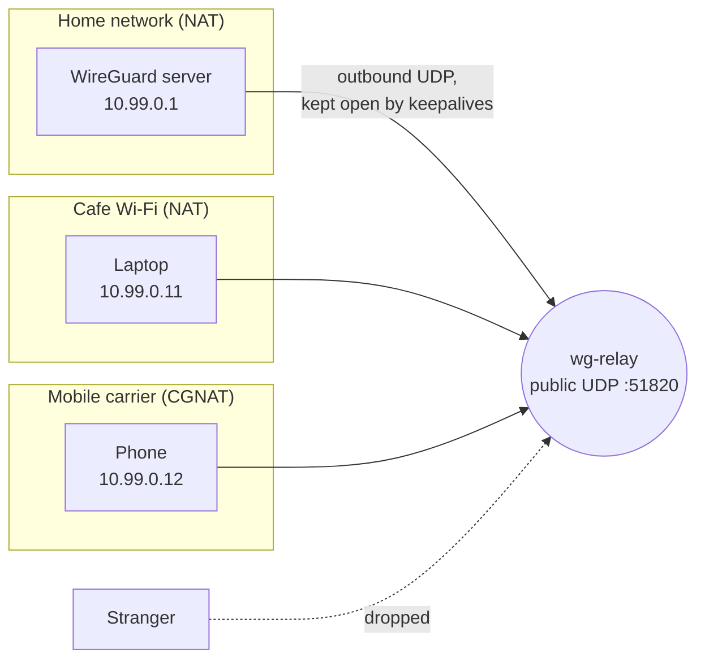

The constraints that shape the design:

| Constraint | Consequence |
|---|---|
| Clients and server run **stock WireGuard** (kernel, wireguard-go, mobile apps) | No custom protocol or agent; the relay must work with packets WireGuard already sends |
| The relay must **never be able to read traffic** | It holds no client↔server keys and forwards datagrams byte-for-byte |
| The relay is on the public internet | It must not become an open reflector, and must not let strangers in |

## 2. The trick: routing ciphertext without keys

If the relay can't decrypt anything, how does it know where a packet goes? It uses two fields that WireGuard leaves readable on purpose:

1. **mac1** on handshake messages. Every initiation and response ends with a 16-byte MAC keyed with `BLAKE2s-256("mac1----" ‖ recipient_public_key)`. It exists so a recipient can cheaply discard junk before doing any cryptography. A side effect: **anyone who knows a candidate public key can test whether a handshake was addressed to it.** The relay knows the public keys of its listed peers, so it tries each one.
2. **Session indexes.** Every handshake carries a random 32-bit `sender_idx` chosen by its sender. Afterwards, every packet *to* that side carries it as `receiver_idx`. The relay watches handshakes go by, notes which index belongs to which address, and routes everything after that by index.

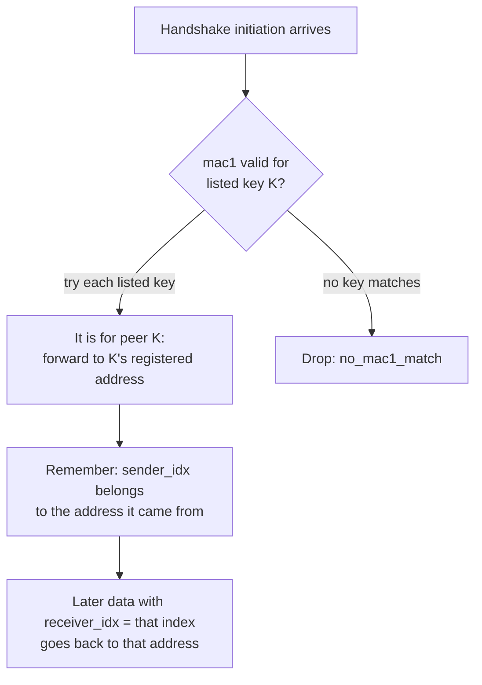

A MAC can only be checked against a key you already have; it can't be reversed to reveal the key. This one fact explains several behaviours later on (for example, why the relay can't route a handshake to an unlisted peer, see [section 8](#8-who-can-start-a-handshake)).

## 3. The WireGuard protocol

The relay never decrypts anything, but nearly every rule in it exists because of something WireGuard does. This section walks through the protocol, following the [WireGuard whitepaper](https://www.wireguard.com/papers/wireguard.pdf), with an eye on what is visible on the wire and what that means for a relay.

The four messages at a glance (fields in **bold** are the only ones the relay reads; integers are little-endian):

| Type | Name | Size | Layout |
|---|---|---|---|
| 1 | Initiation | 148 B | type(1) reserved(3) **sender_idx(4)** ephemeral(32) enc_static(48) enc_timestamp(28) **mac1(16)** mac2(16) |
| 2 | Response | 92 B | type(1) reserved(3) **sender_idx(4) receiver_idx(4)** ephemeral(32) enc_empty(16) **mac1(16)** mac2(16) |
| 3 | Cookie reply | 64 B | type(1) reserved(3) **receiver_idx(4)** nonce(24) enc_cookie(32) |
| 4 | Data | ≥ 32 B | type(1) reserved(3) **receiver_idx(4)** counter(8) encrypted payload |

mac1 covers every byte before it: the first 116 bytes of an initiation, the first 60 of a response.

### 3.1 Keys and primitives

| Key | Lifetime | Purpose |
|---|---|---|
| **Static key pair** | long-term | A peer's identity. The public half is what goes in `PublicKey =` lines and in `relay.toml`. |
| **Ephemeral key pair** | one handshake | Fresh randomness for each session, giving forward secrecy. |
| **Preshared key** (optional) | long-term | 32 symmetric bytes mixed into the handshake, a hedge against future quantum attacks on Curve25519. |
| **Transport keys** | one session (≈ 2 min) | Derived by the handshake, one per direction, used for data packets. |

There is exactly one cipher suite, `Noise_IKpsk2_25519_ChaChaPoly_BLAKE2s`, and no negotiation:

| Primitive | Used for |
|---|---|
| Curve25519 | every Diffie-Hellman exchange |
| ChaCha20-Poly1305 | encrypting handshake fields and data packets |
| XChaCha20-Poly1305 | encrypting cookies (needs a random 24-byte nonce) |
| BLAKE2s | hashing, mac1/mac2, and HKDF key derivation |

With nothing to negotiate there are no version or algorithm fields, and every handshake message has a fixed size. That is what lets the relay validate message types by exact length.

### 3.2 The handshake: Noise IKpsk2

In Noise naming, **I** means the initiator transmits its static key (encrypted) in the first message, and **K** means it already knows the responder's static key, because it is in its config. One round trip gives both sides mutual authentication and fresh, forward-secret keys. The overview:

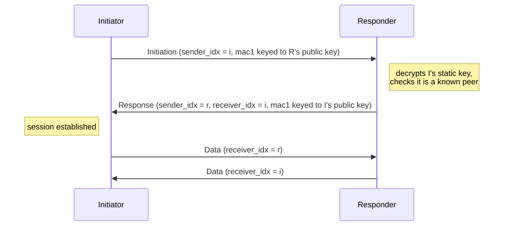

Two running values carry the handshake along. The **chaining key** absorbs every Diffie-Hellman result through HKDF, and every encryption key is split off from it. The **transcript hash** absorbs every byte sent and is used as associated data, so each encrypted field is bound to everything before it; tampering with any earlier byte breaks every later field.

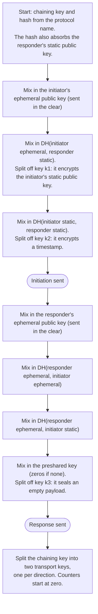

What each Diffie-Hellman exchange contributes:

| Exchange | Who can compute it | What it gives |
|---|---|---|
| initiator ephemeral × responder static | initiator, and only the real responder | hides the initiator's identity: only the responder can decrypt `enc_static` |
| initiator static × responder static | the two real peers | authenticates both static keys in the first message |
| responder ephemeral × initiator ephemeral | only this session's two peers | forward secrecy: stealing static keys later does not reveal this session |
| responder ephemeral × initiator static | responder, and only the real initiator | only the real initiator can derive the transport keys |

The initiation, field by field:

| Field | Bytes | Contents | Readable by |
|---|---|---|---|
| `sender_idx` | 4 | random index the initiator picked for this session | everyone (the relay routes on it) |
| `ephemeral` | 32 | initiator's ephemeral public key | everyone, but it looks random |
| `enc_static` | 48 | initiator's static public key + 16-byte tag | only the responder |
| `enc_timestamp` | 28 | 12-byte TAI64N timestamp + tag | only the responder |
| `mac1` | 16 | MAC keyed with `BLAKE2s("mac1----" ‖ responder public key)` | anyone who knows the responder's public key (the relay does) |
| `mac2` | 16 | zeros, or a MAC keyed with a cookie (section 3.5) | the responder |

And the response:

| Field | Bytes | Contents | Readable by |
|---|---|---|---|
| `sender_idx` | 4 | random index the responder picked | everyone |
| `receiver_idx` | 4 | the initiator's `sender_idx` | everyone |
| `ephemeral` | 32 | responder's ephemeral public key | everyone, but it looks random |
| `enc_empty` | 16 | an authentication tag over nothing; producing it requires the responder's static private key | the initiator |
| `mac1` | 16 | MAC keyed with `BLAKE2s("mac1----" ‖ initiator public key)` | anyone who knows the initiator's public key |

A few consequences matter for the relay:

- **The initiation hides who is calling.** The relay cannot read `enc_static`, so it cannot tell who sent an initiation, only which listed peer it is for. The response's mac1 is keyed to the initiator's public key, so anyone who knows a candidate key could test it; wg-relay does not need to, because the listed peer's own peer list already decides who gets in.
- **Replays are refused by the responder.** It keeps the newest timestamp seen from each peer and rejects anything not newer, so a captured initiation can't be replayed to start a session. The relay's registration leans on this: only a fresh handshake from a listed peer can (re)register it.
- **The responder speaks second in data, too.** The initiator can send data as soon as the response arrives. The responder has to wait for the initiator's first data packet, which confirms both sides derived the same keys. That is why an initiator with nothing to send immediately sends an empty keepalive. You can see it in every handshake through the relay ([section 6](#6-a-client-connects)), and the relay's registration relies on it ([section 5](#5-registration)).

### 3.3 Transport: data packets

| Field | Bytes | Contents |
|---|---|---|
| `receiver_idx` | 4 | the recipient's index, so it finds the right keys without trial decryption |
| `counter` | 8 | the nonce: 0, 1, 2, … per direction, sent in the clear |
| payload | 16 + n | the IP packet, padded to a multiple of 16 bytes, then encrypted with a 16-byte tag |

- **Replay protection:** the receiver tracks counters in a sliding window and drops duplicates and anything too old.
- **Padding** rounds every packet up to 16 bytes, so an observer such as the relay sees sizes in 16-byte steps rather than exact lengths.
- **Keepalives** are data packets with an empty payload: 4 + 4 + 8 + 16 = 32 bytes, which is why 32 is the minimum data size the relay accepts.
- **Overlapping keys:** each peer keeps the previous, current and next keypairs, so packets in flight during a rekey still decrypt.

`receiver_idx` exists so the recipient can find its keys quickly. The relay uses the same field, which is why it can route data without any keys at all.

### 3.4 Timers: when handshakes happen

WireGuard has no connection state machine to configure. A handful of timers decide everything:

| Constant | Value | Rule |
|---|---|---|
| `REKEY_AFTER_TIME` | 120 s | the side that initiated a session starts a new handshake when it sends with a key this old |
| `REJECT_AFTER_TIME` | 180 s | a key this old is never used again, in either direction |
| `REKEY_TIMEOUT` | 5 s | an unanswered initiation is retried after this long (with a fresh `sender_idx`) |
| `REKEY_ATTEMPT_TIME` | 90 s | retries stop after this long, until there is new data to send |
| `KEEPALIVE_TIMEOUT` | 10 s | received data but have nothing to send back for this long: send a keepalive |
| send, no reply | 10 + 5 = 15 s | sent data and heard nothing for this long: assume the session is dead and start a new handshake |
| `PersistentKeepalive` | per peer | send a keepalive every N seconds regardless, to keep NAT mappings open |

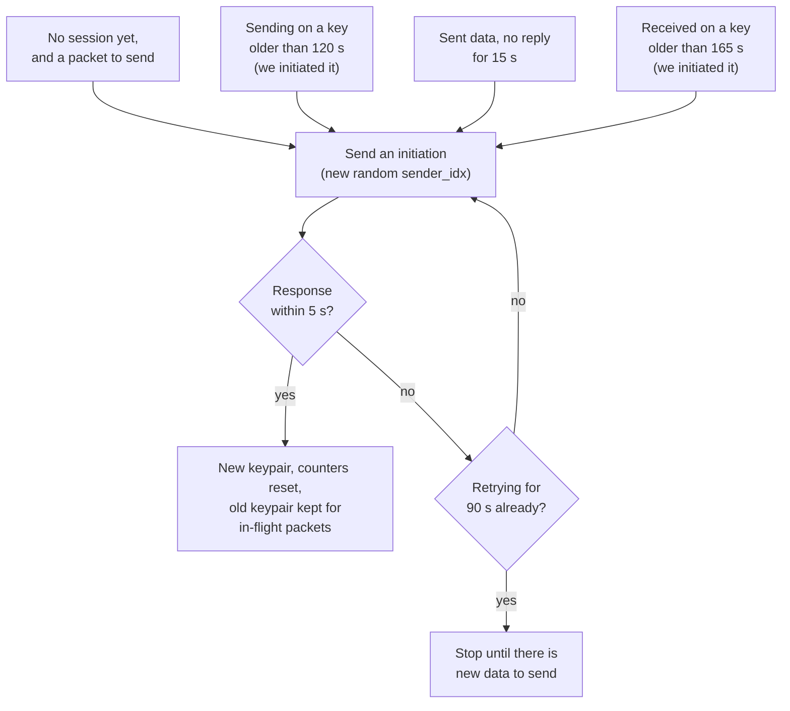

How these numbers show up in the relay:

- The **2-minute rekey** is why the relay keeps learning new indexes, and why old session entries simply age out.
- The relay's **200 s session lifetime** is counted from the handshake and never extended by traffic. It sits just above `REJECT_AFTER_TIME`: WireGuard never uses a key older than 180 s, so the relay never forgets an index that WireGuard might still use, and no entry outlives its keys by more than the 20 s margin, however much traffic is sent on it.
- The **15 s no-reply rule** is why a client that changes network recovers in about 5 to 15 s ([section 14](#14-when-things-move-roaming-and-restarts)).
- **`PersistentKeepalive = 25`** keeps every NAT mapping open, refreshes each listed peer's registration well inside its 180 s TTL, and, because a keepalive counts as sending, keeps sessions rekeying while idle.

### 3.5 Under load: cookies and mac2

A handshake costs the responder several Curve25519 operations, so a flood of initiations could exhaust it. mac1 already filters anyone who doesn't know the responder's public key. For floods from people who do, WireGuard adds a **cookie** exchange that proves the sender can receive packets at the address it claims:


The cookie reply is encrypted with a key derived from the responder's public key, and its associated data is the mac1 of the message it answers. Only someone who sent that initiation can use it, and a spoofed source address never receives it. That is why the relay lets cookie replies through on *pending* sessions ([section 7](#7-sessions-the-state-machine)): without that, a server under load could never complete a handshake through the relay.

**What the relay changes here.** The server sees every packet arriving from the relay's address, so it computes the same cookie for every client. The cookie no longer proves anything about the real sender. Someone who obtains one cookie through the relay could attach a valid mac2 to initiations sent from spoofed addresses, and the server would do the expensive work for each. The relay's per-source rate limit and its forwarding budget ([section 10](#10-the-dispatcher-step-by-step)) are then the only brakes, and each spoofed source gets its own allowance. This is listed under the README's limitations. Possible hardening, not implemented: a global initiation cap per server, or the relay running the cookie exchange itself (it knows each listed peer's public key, which is all the protocol needs).

### 3.6 Cryptokey routing and roaming

Each peer's `AllowedIPs` does two jobs at once:

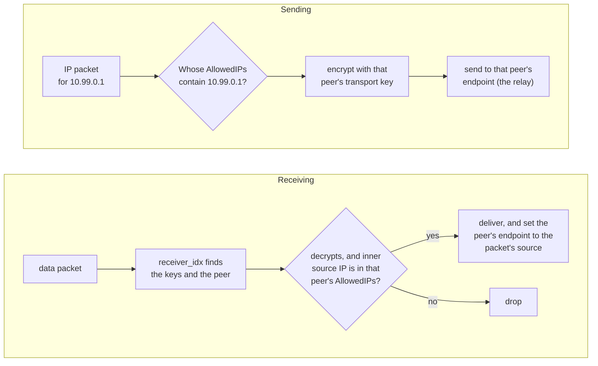

- **Routing out:** the destination IP picks the peer.
- **Filtering in:** a decrypted packet is accepted only if its inner source IP belongs to the peer whose keys decrypted it. A peer cannot spoof another peer's tunnel address.
- **Roaming:** every authenticated packet updates that peer's endpoint to the packet's source. Peers can move freely, and the most recent address wins.

What this means behind the relay:

- Every peer's endpoint is the relay, so from WireGuard's point of view nothing ever roams. The relay absorbs all address changes (section 14).
- A listed peer's `[Peer]` for the relay has `AllowedIPs = 10.99.0.254/32`. Even an attacker holding the relay's private key can only inject packets whose inner source is `10.99.0.254`, and only the relay's pings are routed there. The relay's key opens a door into one `/32` and nothing else.

### 3.7 What survives the relay

| Property | How WireGuard provides it | Through wg-relay |
|---|---|---|
| Confidentiality and integrity | ChaCha20-Poly1305 on every field and packet | unchanged: the relay cannot read or alter anything |
| Mutual authentication | static keys inside Noise IK | unchanged: the relay never holds any peer's private key |
| Forward secrecy | ephemeral Diffie-Hellman, keys replaced every 2 min | unchanged |
| Replay protection | handshake timestamps, data counters | unchanged |
| Silence towards strangers | no reply without a valid mac1 and handshake | kept: the relay never answers forwarded traffic |
| Identity hiding | initiator's static key encrypted to the responder | partly lost: mac1 tells the relay which listed peer is called; the caller stays hidden, though the response's mac1 can be tested against a guessed key |
| Flood resistance | mac1, plus cookies bound to the sender's address | weakened: the server sees one address, so cookies stop distinguishing clients (section 3.5) |
| Hidden packet sizes | padding to 16 bytes | unchanged; the relay sees padded sizes and timing |

## 4. The relay's state

The relay is a single-threaded state machine (`Relay` in `src/relay/mod.rs`). `Relay::handle(src, datagram, now)` does no I/O: it returns a verdict, and the socket loop in `src/app.rs` acts on it.

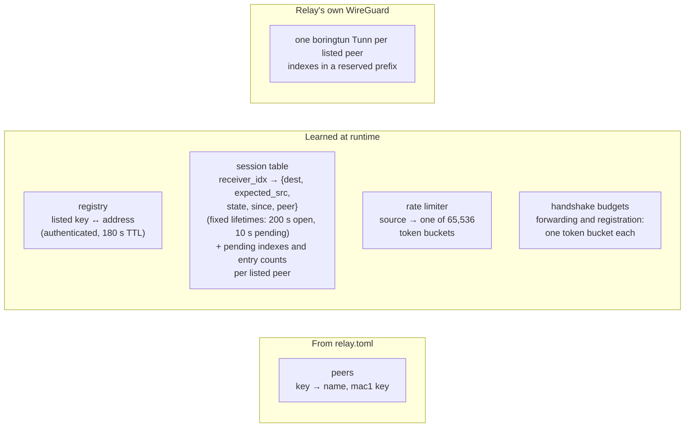

| Table | Written when | Read when | Expires |
|---|---|---|---|
| `registry` | a packet **authenticates** on a listed peer's relay tunnel | finding a listed peer's address | 180 s without authenticated traffic |
| `sessions` | a handshake is forwarded (pending) or accepted (open); never by forwarded data or cookie replies | every type 2, 3 and 4 packet | 200 s after the handshake was accepted, whatever the traffic (10 s after the initiation while pending); a pending entry also goes when its listed peer has 1,024 newer ones |
| `rate limiter` | every initiation | every initiation | never: a fixed array of buckets, so memory is constant |
| `forwarding budget` | after each mac1 scan | every initiation not for the relay | never; refills continuously |
| `registration budget` | after each registration attempt from an unregistered address | every relay-bound initiation from an unregistered address | never; refills continuously |

The relay never trusts an address it hasn't either authenticated (listed peers) or seen in a handshake it forwarded (everyone else). Each session also records the listed peer it was routed to, so removing that peer from the config revokes the session ([section 13](#13-reload-sighup)).

## 5. Registration

The relay is an ordinary WireGuard peer of each listed peer, with its own key pair and a `/32` tunnel address (`10.99.0.254`). This tunnel carries no user traffic; it exists so the relay learns, **with cryptographic proof**, where each listed peer is right now. The example below is a server called "main", the usual thing to list, but any peer can be listed: a laptop that other peers should be able to reach registers the same way.

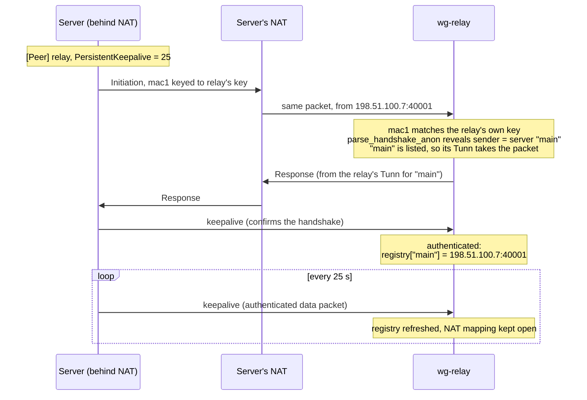

What counts as authenticated: a data packet or a keepalive that decrypts on that peer's tunnel. An initiation alone does not count, because a captured one could be replayed from another address (for instance after a relay restart, when the replay timestamp is forgotten); the peer's first keepalive right after the handshake does. A cookie reply never counts either, because producing one proves nothing about who you are. If an authenticated packet arrives from a **new** address (the peer's NAT rebound), the registry moves the peer there and every session using the old address is rewritten.

Registration is refused for keys that aren't listed (`registration_unknown_key`): unlisted peers never talk to the relay directly.

The relay also answers pings to its tunnel IP, so `ping 10.99.0.254` from a listed peer is a one-line registration check.

## 6. A client connects

The client is unlisted: its config just lists the server with `Endpoint = relay:51820`. Here is a full connection, with what the relay records at each step. The client's NAT gives it the public address `C`; the server is listed and registered at `S`.

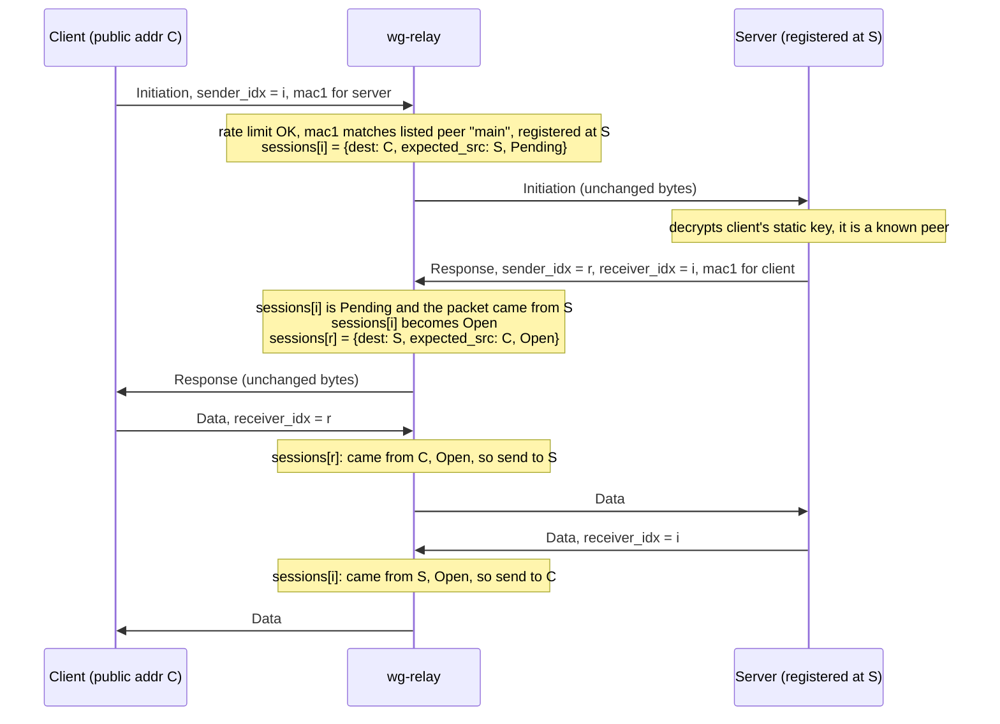

After the handshake there are two session entries, one per direction. Each one says where packets with that index go **and the only address allowed to send them**. That second field is what stops anyone else from injecting packets into the session, even if they guess the index. And because `sessions[i]` expects the response from `S`, only the listed peer itself can open the session.

## 7. Sessions: the state machine

Every entry in the session table follows this life cycle:

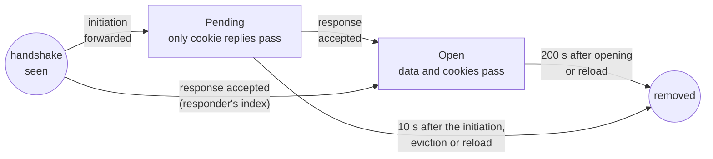

What each state lets through, always only from `expected_src`:

| Packet | `Pending` | `Open` |
|---|---|---|
| Type 2, response | yes (section 9) | **no** (`session_not_pending`): one response per initiation |
| Type 3, cookie reply | **yes**, so a peer under load can still answer | yes |
| Type 4, data | **no** (`session_not_open`) | yes |

Lifetimes are fixed. An open entry goes 200 s after its handshake was accepted, however much traffic it carries, and a pending entry 10 s after its initiation, however many cookie replies pass through it. Forwarding data and cookie replies only reads the table. This is safe because a WireGuard session rekeys every 2 minutes, which creates new indexes, and never uses a key older than 180 s, so by the time an entry goes its traffic has long moved to the next session's entries. It also means nobody can keep an entry alive by sending: a client that a server has removed from its config cannot keep the relay forwarding junk to the server's address beyond the lifetime of its last accepted handshake.

Quotas keep the table bounded:

- Each listed peer may have at most 1,024 pending entries: a new initiation for a peer at its quota evicts that peer's oldest pending entry (counted as `pending_evicted`), so spoofed initiations aimed at one listed peer only compete with handshakes to that peer, and a legitimate handshake survives as long as it is answered before 1,024 newer initiations to the same peer arrive.
- Each listed peer may have at most 65,536 entries in all, pending and open, room for about 16,000 busy sessions (a busy session holds four entries: its current pair and, until it expires, the previous one). A listed peer that answers spoofed initiations with fabricated responses gains two open entries per answer; at its quota, new initiations to it and responses from it are dropped (`peer_quota`) until its entries expire, and other peers are unaffected.
- At most 262,144 entries may be pending in total (`too_many_pending`), so a flood of initiations leaves most of the table to open sessions; with the default budgets, a flood cannot create pending entries fast enough to reach it.
- At most 917,504 entries may exist in total (`too_many_sessions`), a memory backstop of about 135 MB ([reference](reference.md#session-table)).

When an expiry sweep leaves the table mostly empty, it gives the memory back. If a handshake picks an index that a live entry of a different address pair already holds (probability 2⁻³² per pair by accident), it is dropped (`index_in_use`) and the peer retries with a new index, so an index in use can never be taken over. A live open entry is never replaced at all, not even by its own address pair: an initiation re-sent or replayed with the index of an open session is dropped (`index_in_use`), so it can neither cut the session off by turning the entry back into a pending one nor restart its lifetime. WireGuard uses a fresh index for every initiation, so real peers never hit this.

## 8. Who can start a handshake

An initiation's mac1 is keyed to the **responder's** public key, so the relay can route an initiation only to a peer whose key it has: a listed, registered peer. Who initiated doesn't matter.

| Initiator → responder | Through the relay |
|---|---|
| unlisted → listed (a laptop calls the server) | works: the normal case |
| listed → listed (two servers, or a server and a listed laptop) | works, in both directions |
| listed → unlisted (the server calls a laptop) | dropped (`no_mac1_match`): no key matches |
| unlisted → unlisted | dropped (`no_mac1_match`) |

Listed peers therefore form a full mesh: each can start a handshake with any other. Here the server starts one towards a laptop that is listed too, and registered at `L`:

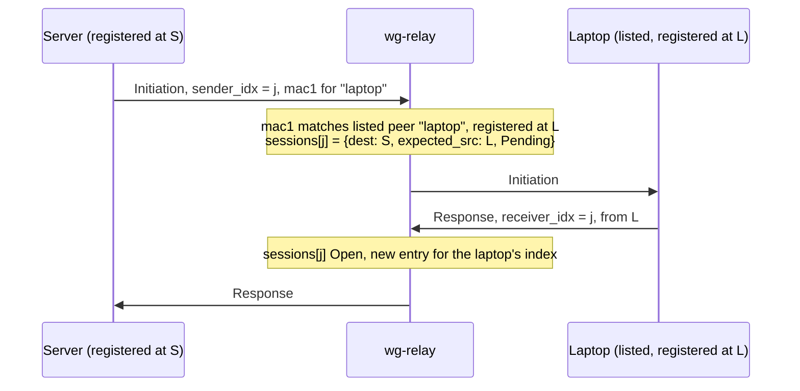

The gap is the server calling an unlisted laptop. In practice it rarely matters: the laptop starts the first handshake, and in WireGuard the side that started a session also does its timed rekeys ([section 3.4](#34-timers-when-handshakes-happen)), so with `PersistentKeepalive` the laptop keeps re-handshaking on its own. It mostly shows up after the server restarts, until the laptop next sends something. A peer that must always be reachable can simply be listed.

## 9. Access control

There is one rule: **a session opens only when a listed peer answers from its registered address.** Anyone may send an initiation to a registered listed peer, subject to the per-source rate limit, and the listed peer's own WireGuard decides whether it knows the sender. Strangers' initiations reach it and are dropped there, silently. The relay's checks on the response only make sure it really is the listed peer answering, exactly once:

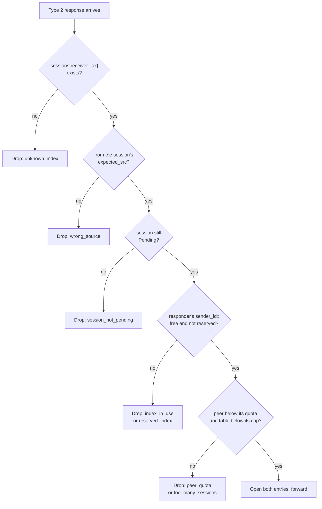

What each list decides:

| List | Decides |
|---|---|
| `relay.toml` | which peers can register, and so be reached through the relay |
| each listed peer's WireGuard config | who may talk to that peer: the only authentication there is |

To revoke a listed peer, remove it from `relay.toml` and send SIGHUP: its registration and every session routed to it go at once. To revoke an unlisted peer, remove it from the listed peers' WireGuard configs. The relay does not limit how many unlisted peers a listed peer accepts, so it cannot cap who uses its bandwidth beyond the per-source handshake rate.

## 10. The dispatcher, step by step

Every datagram goes through `Relay::route` (`src/relay/mod.rs`). The checks are ordered from cheapest to most expensive, so junk is rejected before any cryptography happens. The first check drops datagrams whose source could never receive a reply (port 0, an unspecified, multicast or IPv4 broadcast address, after unmapping IPv4-mapped IPv6), so such an address is never stored as a session's destination.

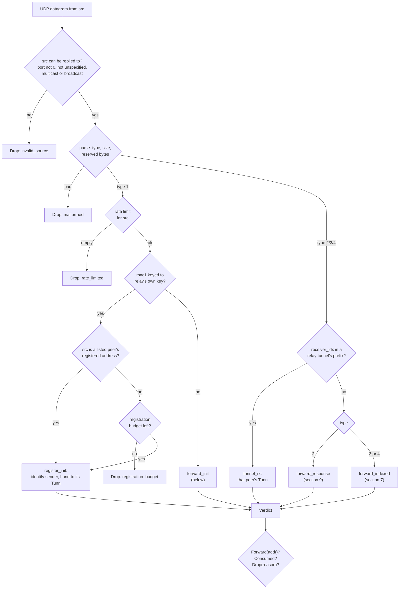

Initiations are the only packets that cost real CPU before anyone is authenticated. Finding the destination means hashing the mac1 against the listed keys, eight at a time with SIMD; a registration attempt costs an X25519 operation, about as much as 400 key checks. The two paths have separate token buckets, so a flood on one cannot starve the other: the forwarding scan may spend 1,000,000 key checks per second, registration attempts 200,000 (500 attempts). Telling the two apart costs one mac1 check against the relay's own key. A relay-bound initiation from the address a listed peer is currently registered from skips the registration budget, limited only by its per-source allowance, so a flood of registration attempts from elsewhere cannot stop registered peers from re-handshaking with the relay. While a budget is empty, initiations on that path are dropped after at most one hash, so a flood from many sources costs little and data keeps flowing. Legitimate handshakes on the flooded path still compete with the flood: junk initiations can delay forwarded handshakes (a mac1 cannot be looked up by index, so each costs a full scan), and a registration flood can delay peers registering from a new address, but open sessions are unaffected.

Each forwarding rule returns `Result<SocketAddr, Reason>`; `handle()` turns that into a `Verdict`, counts it, and logs drops at debug level with their reason. The socket loop sends `Forward` datagrams unchanged and drains the relay tunnels' own output (handshake responses, keepalives, ping replies) after every event.

The initiation rule in full:

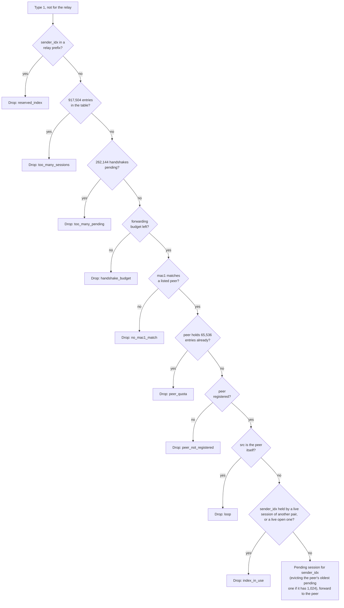

## 11. Index space: relay indexes vs forwarded indexes

The relay's own tunnels need session indexes too, and they share the `receiver_idx` field with forwarded traffic. If a forwarded session ever used an index the relay owns, the relay would swallow its packets. So the space is split:


- boringtun numbers a tunnel's sessions `prefix << 8 | counter`, so each relay tunnel uses at most 256 indexes, all under one prefix.
- Each listed peer's tunnel gets a **random** prefix that no live forwarded session is using at the time it is created.
- A forwarded handshake whose `sender_idx` falls inside a relay prefix is dropped (`reserved_index`). WireGuard simply retries with a new random index.

Together these guarantee the two kinds of index never collide, and a packet whose `receiver_idx` is in a relay prefix can go straight to that relay tunnel.

## 12. Timers and expiry

| Timer | Value | Where | Purpose |
|---|---|---|---|
| Peer keepalive | 25 s | node configs (`PersistentKeepalive`) | keeps NAT mappings open, refreshes registrations |
| WireGuard rekey | about 2 min | WireGuard itself | new keys and new indexes |
| Registration TTL | 180 s | `REGISTRY_TTL` | a listed peer silent for 3 min is forgotten |
| Session lifetime | 200 s after the handshake, not extended by traffic | `SESSION_TTL` | indexes from old handshakes age out; nobody can keep an entry alive by sending |
| Pending lifetime | 10 s after the initiation, not extended by cookie replies | `PENDING_TTL` | unanswered initiations do not pile up |
| Relay tick | 250 ms | `app.rs` | runs relay tunnel timers |
| Table sweep | 1 s | `SWEEP_INTERVAL` | expires tables, shrinks them when mostly empty |
| Stats log | 60 s | `app.rs` | logs all counters, including per-reason rejects |
| Rate limit | `handshake_rate_per_ip`, burst 2 s worth | `relay.toml` | caps initiations per source (IPv4 address or IPv6 /64) |
| Forwarding budget | 1,000,000 mac1 checks/s, burst 1 s | `FORWARD_WORK_PER_SEC` | caps CPU spent finding forwarded handshakes' destinations |
| Registration budget | 200,000 mac1 checks/s (500 attempts), burst 1 s | `REGISTRATION_WORK_PER_SEC` | caps X25519 work on registration attempts from unregistered addresses |
| Pending quota | 1,024 per listed peer; 262,144 in total | `MAX_PENDING_PER_PEER`, `MAX_PENDING` | a flood at one listed peer evicts only that peer's oldest pending entries; the total leaves room for open sessions |
| Session quota | 65,536 entries per listed peer; 917,504 in total | `MAX_SESSIONS_PER_PEER`, `MAX_SESSIONS` | one listed peer cannot take the whole table; the total bounds memory at about 135 MB |

The values nest deliberately: a healthy listed peer refreshes its registration about seven times per TTL, and a session in use is replaced by a rekey every 2 minutes, so its entries are idle well before they expire 200 s after their handshake. WireGuard stops using a session's keys at 180 s at the latest, which is why the relay can expire entries on a fixed schedule instead of watching traffic.

```mermaid
gantt
    title One server and one client over five minutes (relative seconds)
    dateFormat X
    axisFormat %s
    section Server
    registered, keepalive every 25 s     :0, 300
    section Session 1
    traffic                              :done, 0, 120
    replaced, expires at 200 s           :120, 200
    section Session 2
    traffic                              :done, 120, 240
    replaced, expires at 320 s           :240, 300
    section Session 3
    traffic                              :done, 240, 300
```

## 13. Reload (SIGHUP)

`kill -HUP` re-reads `relay.toml`. If the file is invalid, the running config stays and an error is logged. Changes to `listen` or `private_key` need a restart; everything else applies at once:

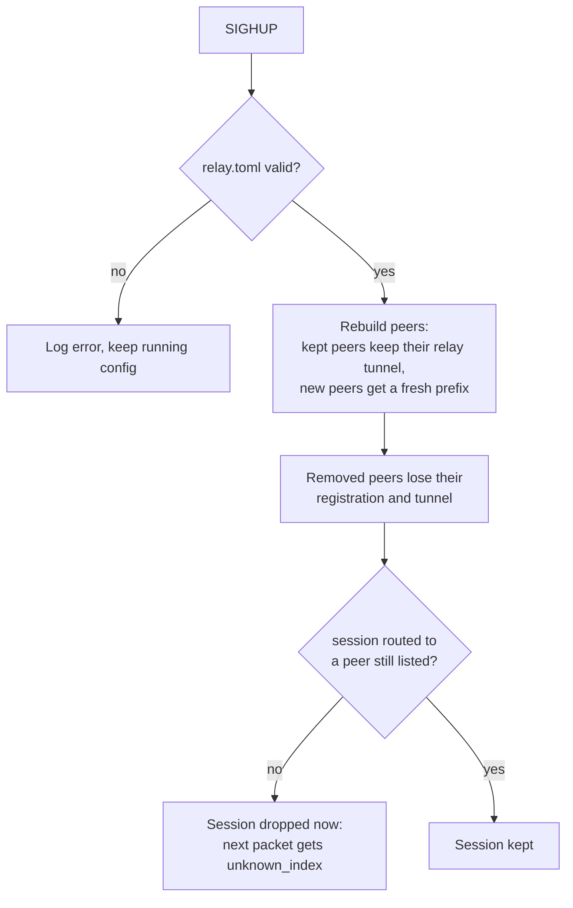

Revocation is immediate, not "at the next rekey": the very next packet of any session with a removed peer is rejected, in both directions. Sessions with peers that are still listed are untouched.

## 14. When things move: roaming and restarts

**A listed peer's NAT rebinds.** Its next keepalive to the relay authenticates from the new address; the registry moves it and every session entry is rewritten. Until then (at most one keepalive interval, 25 s) traffic in both directions is lost: packets for it go to the old address, and its own packets arrive from an address no session expects. A listed peer that changes network (Wi-Fi to cellular) recovers the same way.

**An unlisted peer changes network** (Wi-Fi to cellular). Its packets now come from a new address that no session expects, so they are dropped. WireGuard notices it is getting no replies and starts a fresh handshake, which then works normally:

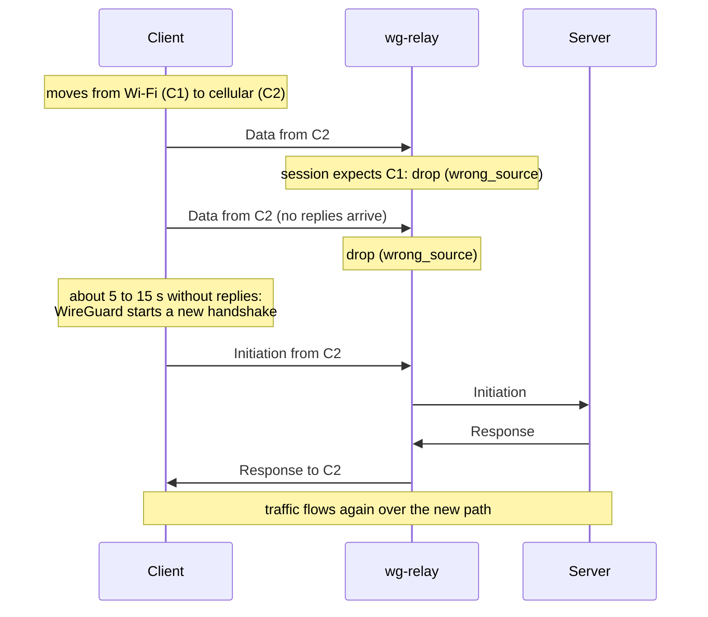

The relay can't follow the client sooner because an unlisted peer never authenticates to the relay; accepting its new address on its word would let anyone hijack sessions.

**The server restarts.** It re-registers within seconds (its first packet to the relay is a handshake). Client sessions are gone on the server side; clients' next data gets no reply and they re-handshake as above. Handshakes the server starts reach only listed peers ([section 8](#8-who-can-start-a-handshake)).

## 15. Security model

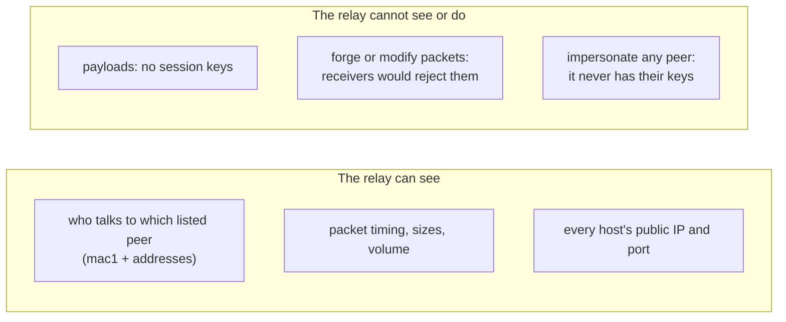

**What stops abuse:**

| Threat | Defence |
|---|---|
| Using the relay as a reflector or amplifier | It only sends to authenticated listed-peer addresses or addresses from a handshake it forwarded; replies are never larger than requests; forwarded traffic never triggers relay-generated replies |
| Strangers reaching a listed peer | The listed peer's own WireGuard peer list drops them |
| Injecting packets into someone's session | Every non-handshake packet must come from the session's `expected_src` |
| Redirecting a listed peer's traffic | Registration requires a full WireGuard handshake with that peer's key; replays fail WireGuard's timestamp and counter checks |
| Handshake floods | Per-source token buckets, then separate work budgets for forwarding scans and registration attempts, checked before the mac1 scan or key exchange: floods are shed cheaply, forwarding continues, a flood on one path does not starve the other, and registered peers re-handshake with the relay without touching the registration budget |
| Crowding out pending handshakes | Each listed peer has its own quota of 1,024 pending entries, evicting its oldest first, so a flood aimed at one listed peer cannot refuse handshakes to the others |
| A listed peer filling the session table by answering spoofed initiations | Each listed peer may hold at most 65,536 entries, pending and open, so it can only refuse new sessions to itself |
| Exhausting memory with spoofed sources | The rate limiter is a fixed array; the session table is capped at 917,504 entries (about 135 MB), of which at most 262,144 pending; tables shrink after a flood |
| Keeping a session alive with junk, e.g. a client the server has removed | Entries live a fixed time from their handshake (200 s open, 10 s pending); neither data nor cookie replies extend them, and an open entry cannot be reset by re-sending its initiation |
| Spoofed sources that cannot receive replies | Datagrams from port 0, unspecified, multicast or broadcast addresses are dropped first (`invalid_source`) |
| A removed listed peer lingering | SIGHUP drops its registration and sessions immediately |
| Unapproved peers using the relay's bandwidth | Not prevented: a listed peer can accept any number of unlisted peers; only handshakes are rate-limited |

**Known residual risks**, detailed in the [reference's limitations](reference.md#limitations): a flood from sources spread over all 65,536 rate-limit buckets, at roughly 65,536 × `handshake_rate_per_ip` initiations per second, empties every bucket, registered listed peers' included, and blocks their re-handshakes until it ends; and packets spoofed from a listed peer's registered `ip:port` are trusted as that peer on the forwarding path (the source address is the only check), so they can open sessions for pending initiations. The quotas bound the memory this can take, but it remains a denial-of-service lever against that one peer.

**What the relay's private key is worth to an attacker:** it opens only the registration tunnels, which carry nothing but keepalives and pings to `10.99.0.254/32`. With it, an attacker could pose as the relay to listed peers, which gains them the same position as an on-path attacker: they can drop traffic, but not read it.

## 16. Code map

```mermaid
flowchart TD
    main["main.rs<br/>parse CLI, logging, report errors"] --> app["app.rs<br/>Cli, socket loop, timers, signals"]
    app --> cfg["config/<br/>relay.toml, Rate, Summary, ConfigError"]
    app --> relay["relay/mod.rs<br/>Relay, handle, route, tick"]
    relay --> fwd["relay/forward.rs<br/>forward_init, forward_response,<br/>forward_indexed"]
    relay --> regm["relay/registration.rs<br/>register_init, tunnel_rx, ICMP"]
    relay --> rel["relay/reload.rs<br/>reload"]
    relay --> rsn["relay/reason.rs + metrics.rs<br/>Reason, Verdict, counters"]
    relay --> tbl["tables.rs<br/>Registry, SessionTable, RateLimiter"]
    fwd --> pkt["packet/<br/>parse, mac1, SessionIdx"]
    regm --> bt["boringtun Tunn<br/>(relay's own WireGuard)"]
    cfg --> key["key/<br/>PeerKey, PrivateKey"]
```

Following one data packet through the code:

1. `app.rs` `serve()` receives it with `recv_from` and calls `relay.handle(src, bytes, now)`.
2. `handle()` calls `route()`, which calls `packet::parse()` and gets `Packet::Data { receiver }`.
3. `relay_tunnel(receiver)` finds no relay prefix, so `forward_indexed()` looks up `sessions.get(receiver)`, checks `expected_src` and the state, and writes nothing: the entry's lifetime is fixed.
4. It returns `Ok(dest)`; `handle()` records `Verdict::Forward(dest)` in the metrics.
5. `serve()` calls `send_to(bytes, dest)` with the original, unmodified bytes.

## 17. How it is tested

| Layer | What | Where |
|---|---|---|
| Unit | session table: fixed lifetimes, per-peer pending eviction, per-peer quota, global cap and exact counts; read-only forwarding, source validation, eviction counter; registry, rate limiter, handshake budgets and their independence, `Rate` parsing, ICMP reply | `#[cfg(test)]` modules in `src/` |
| Packet | parsing, size checks, mac1 matching and batched search on real packets made by boringtun | `tests/packet.rs` |
| Config | defaults, exact `ConfigError` for each bad input, `--check-config` | `tests/config.rs` |
| Relay, in-process | full handshakes between boringtun peers through `Relay::handle` (unlisted to listed, listed to listed, listed to unlisted refused), reload, roaming, reserved indexes, index takeover, re-sent initiations, fixed session lifetimes under traffic, IPv4-mapped sources, rate limits, registration and pending floods, 10 000 mutated packets | `tests/relay.rs` |
| End-to-end | real kernel WireGuard in network namespaces behind real NATs | `tests/netns.sh` |

The end-to-end topology:

```mermaid
flowchart LR
    subgraph relayns["relay namespace"]
        BR["br0 192.0.2.1<br/>wg-relay :51820<br/>tcpdump"]
    end
    subgraph s["server (listed)"]
        SRV["srv<br/>wg0 10.99.0.1"] --- NS["natsrv<br/>MASQUERADE"]
    end
    subgraph c1s["client 1 (unlisted)"]
        C1["c1<br/>wg0 10.99.0.11"] --- N1["natc1"]
    end
    subgraph c2s["client 2 (listed)"]
        C2["c2<br/>wg0 10.99.0.12"] --- N2["natc2"]
    end
    subgraph sts["stranger"]
        ST["st<br/>wg0 10.99.0.13"] --- N3["natst"]
    end
    NS --- BR
    N1 --- BR
    N2 --- BR
    N3 --- BR
```

`srv` and `c2` are listed and register; `c1` and the stranger `st` are not, and the server doesn't know `st`. The test checks that both clients reach the server and the stranger doesn't; that rekeys work, including one the server starts towards the listed `c2`; that SIGHUP after removing `srv` cuts its sessions off at once; and, from a packet capture at the relay, that forwarded handshakes cannot be opened with the relay's key, every forwarded packet is byte-identical, and the ping payload never appears on the wire.
