# How wg-relay works

This document walks through the relay from first principles: the problem, the small piece of WireGuard it relies on, the life of every kind of packet, the state it keeps, and why each check exists. The [README](../README.md) is the quick reference; this is the long version.

- [1. The problem](#1-the-problem)
- [2. The trick: routing ciphertext without keys](#2-the-trick-routing-ciphertext-without-keys)
- [3. The WireGuard protocol](#3-the-wireguard-protocol)
- [4. The relay's state](#4-the-relays-state)
- [5. Server registration](#5-server-registration)
- [6. A client connects](#6-a-client-connects)
- [7. Sessions: the state machine](#7-sessions-the-state-machine)
- [8. Server-initiated handshakes and rekeys](#8-server-initiated-handshakes-and-rekeys)
- [9. Client gates: `none` vs `response`](#9-client-gates-none-vs-response)
- [10. The dispatcher, step by step](#10-the-dispatcher-step-by-step)
- [11. Index space: relay indexes vs forwarded indexes](#11-index-space-relay-indexes-vs-forwarded-indexes)
- [12. Timers and expiry](#12-timers-and-expiry)
- [13. Reload (SIGHUP)](#13-reload-sighup)
- [14. When things move: roaming and restarts](#14-when-things-move-roaming-and-restarts)
- [15. Security model](#15-security-model)
- [16. Code map](#16-code-map)
- [17. How it is tested](#17-how-it-is-tested)

## 1. The problem

A WireGuard server sits on a home or office network behind NAT, with no public address and no port forward. Its clients (laptops, phones) are behind NATs too. Neither side can receive an unsolicited packet, so neither can start a connection to the other.

Both sides *can* send packets out to a host on the internet, and NATs let the replies back in. wg-relay is that host: everyone points their WireGuard `Endpoint` at it, and it passes packets between them.

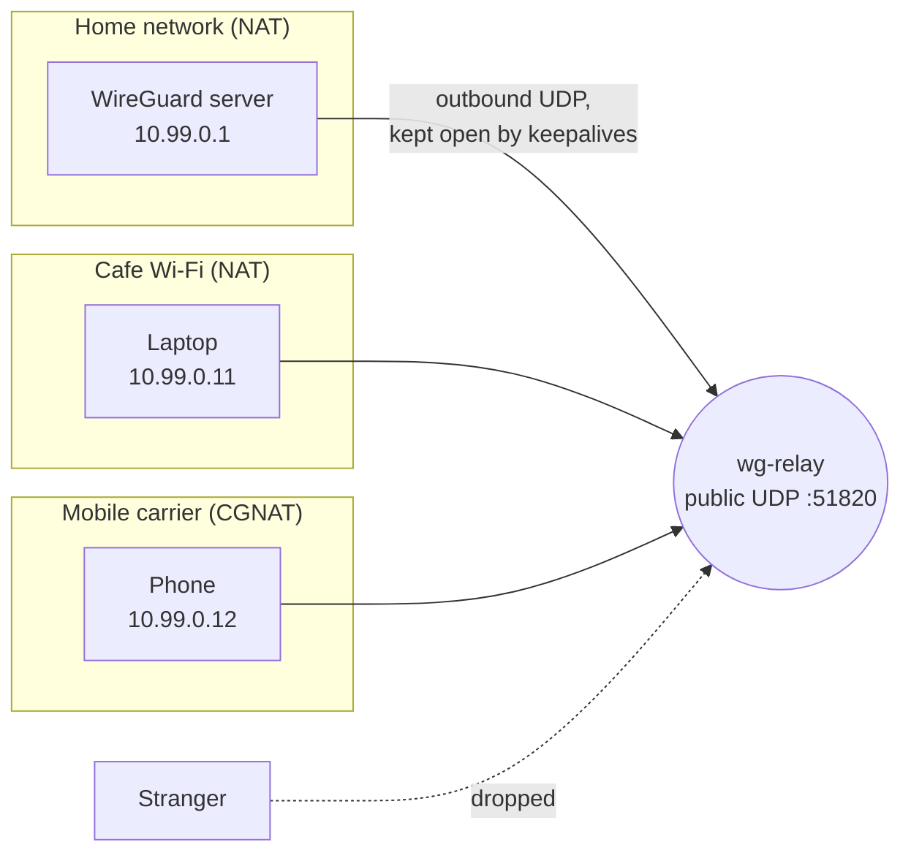

The constraints that shape the design:

| Constraint | Consequence |
|---|---|
| Clients and server run **stock WireGuard** (kernel, wireguard-go, mobile apps) | No custom protocol or agent; the relay must work with packets WireGuard already sends |
| The relay must **never be able to read traffic** | It holds no client↔server keys and forwards datagrams byte-for-byte |
| The relay is on the public internet | It must not become an open reflector, and must refuse strangers |

## 2. The trick: routing ciphertext without keys

If the relay can't decrypt anything, how does it know where a packet goes? It uses two fields that WireGuard leaves readable on purpose:

1. **mac1** on handshake messages. Every initiation and response ends with a 16-byte MAC keyed with `BLAKE2s-256("mac1----" ‖ recipient_public_key)`. It exists so a recipient can cheaply discard junk before doing any cryptography. A side effect: **anyone who knows a candidate public key can test whether a handshake was addressed to it.** The relay knows the public keys of its servers (and listed clients), so it tries each one.
2. **Session indexes.** Every handshake carries a random 32-bit `sender_idx` chosen by its sender. Afterwards, every packet *to* that side carries it as `receiver_idx`. The relay watches handshakes go by, notes which index belongs to which address, and routes everything after that by index.

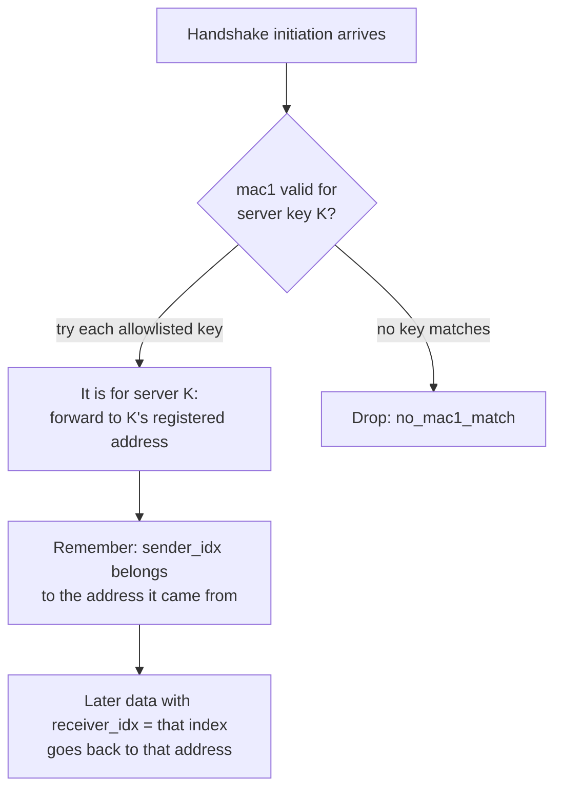

A MAC can only be checked against a key you already have; it can't be reversed to reveal the key. This one fact explains several behaviours later on (for example, why the relay can't route a server's handshake to a client it has never heard of, see [section 8](#8-server-initiated-handshakes-and-rekeys)).

## 3. The WireGuard protocol

The relay never decrypts anything, but nearly every rule in it exists because of something WireGuard does. This section walks through the protocol, following the [WireGuard whitepaper](https://www.wireguard.com/papers/wireguard.pdf), with an eye on what is visible on the wire and what that means for a relay.

The four messages at a glance (fields in **bold** are the only ones the relay reads; integers are little-endian):

| Type | Name | Size | Layout |
|---|---|---|---|
| 1 | Initiation | 148 B | type(1) reserved(3) **sender_idx(4)** ephemeral(32) enc_static(48) enc_timestamp(28) **mac1(16)** mac2(16) |
| 2 | Response | 92 B | type(1) reserved(3) **sender_idx(4) receiver_idx(4)** ephemeral(32) enc_empty(16) **mac1(16)** mac2(16) |
| 3 | Cookie reply | 64 B | type(1) reserved(3) **receiver_idx(4)** nonce(24) enc_cookie(32) |
| 4 | Data | ≥ 32 B | type(1) reserved(3) **receiver_idx(4)** counter(8) encrypted payload |

mac1 covers every byte before it: the first 116 bytes of an initiation, the first 60 of a response.

### 3.1 Keys and primitives

| Key | Lifetime | Purpose |
|---|---|---|
| **Static key pair** | long-term | A peer's identity. The public half is what goes in `PublicKey =` lines and in `relay.toml`. |
| **Ephemeral key pair** | one handshake | Fresh randomness for each session, giving forward secrecy. |
| **Preshared key** (optional) | long-term | 32 symmetric bytes mixed into the handshake, a hedge against future quantum attacks on Curve25519. |
| **Transport keys** | one session (≈ 2 min) | Derived by the handshake, one per direction, used for data packets. |

There is exactly one cipher suite, `Noise_IKpsk2_25519_ChaChaPoly_BLAKE2s`, and no negotiation:

| Primitive | Used for |
|---|---|
| Curve25519 | every Diffie-Hellman exchange |
| ChaCha20-Poly1305 | encrypting handshake fields and data packets |
| XChaCha20-Poly1305 | encrypting cookies (needs a random 24-byte nonce) |
| BLAKE2s | hashing, mac1/mac2, and HKDF key derivation |

With nothing to negotiate there are no version or algorithm fields, and every handshake message has a fixed size. That is what lets the relay validate message types by exact length.

### 3.2 The handshake: Noise IKpsk2

In Noise naming, **I** means the initiator transmits its static key (encrypted) in the first message, and **K** means it already knows the responder's static key, because it is in its config. One round trip gives both sides mutual authentication and fresh, forward-secret keys. The overview:

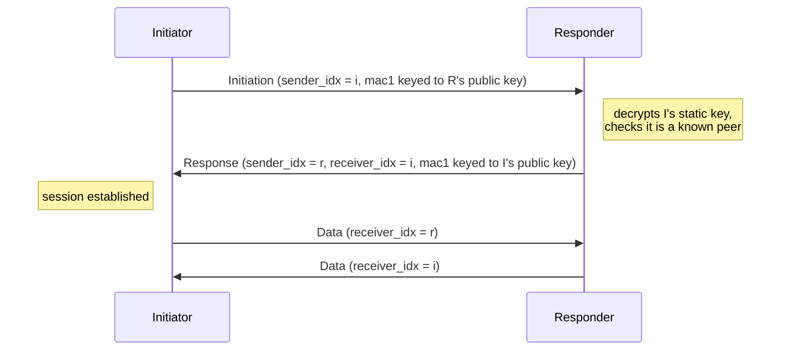

Two running values carry the handshake along. The **chaining key** absorbs every Diffie-Hellman result through HKDF, and every encryption key is split off from it. The **transcript hash** absorbs every byte sent and is used as associated data, so each encrypted field is bound to everything before it; tampering with any earlier byte breaks every later field.


What each Diffie-Hellman exchange contributes:

| Exchange | Who can compute it | What it gives |
|---|---|---|
| initiator ephemeral × responder static | initiator, and only the real responder | hides the initiator's identity: only the responder can decrypt `enc_static` |
| initiator static × responder static | the two real peers | authenticates both static keys in the first message |
| responder ephemeral × initiator ephemeral | only this session's two peers | forward secrecy: stealing static keys later does not reveal this session |
| responder ephemeral × initiator static | responder, and only the real initiator | only the real initiator can derive the transport keys |

The initiation, field by field:

| Field | Bytes | Contents | Readable by |
|---|---|---|---|
| `sender_idx` | 4 | random index the initiator picked for this session | everyone (the relay routes on it) |
| `ephemeral` | 32 | initiator's ephemeral public key | everyone, but it looks random |
| `enc_static` | 48 | initiator's static public key + 16-byte tag | only the responder |
| `enc_timestamp` | 28 | 12-byte TAI64N timestamp + tag | only the responder |
| `mac1` | 16 | MAC keyed with `BLAKE2s("mac1----" ‖ responder public key)` | anyone who knows the responder's public key (the relay does) |
| `mac2` | 16 | zeros, or a MAC keyed with a cookie (section 3.5) | the responder |

And the response:

| Field | Bytes | Contents | Readable by |
|---|---|---|---|
| `sender_idx` | 4 | random index the responder picked | everyone |
| `receiver_idx` | 4 | the initiator's `sender_idx` | everyone |
| `ephemeral` | 32 | responder's ephemeral public key | everyone, but it looks random |
| `enc_empty` | 16 | an authentication tag over nothing; producing it requires the responder's static private key | the initiator |
| `mac1` | 16 | MAC keyed with `BLAKE2s("mac1----" ‖ initiator public key)` | anyone who knows the initiator's public key |

A few consequences matter for the relay:

- **The initiation hides who is calling; the response reveals who was accepted.** The relay cannot read `enc_static`, so it cannot tell which client sent an initiation. The response's mac1, however, is keyed to the initiator's public key. A relay that knows candidate client keys can test which one the server just accepted. That is the whole basis of the `response` gate.
- **Replays are refused by the responder.** It keeps the newest timestamp seen from each peer and rejects anything not newer, so a captured initiation can't be replayed to start a session. The relay's server registration leans on this: only a fresh handshake from the server can (re)register it.
- **The responder speaks second in data, too.** The initiator can send data as soon as the response arrives. The responder has to wait for the initiator's first data packet, which confirms both sides derived the same keys. That is why an initiator with nothing to send immediately sends an empty keepalive. You can see it in every handshake through the relay ([section 6](#6-a-client-connects)).

### 3.3 Transport: data packets

| Field | Bytes | Contents |
|---|---|---|
| `receiver_idx` | 4 | the recipient's index, so it finds the right keys without trial decryption |
| `counter` | 8 | the nonce: 0, 1, 2, … per direction, sent in the clear |
| payload | 16 + n | the IP packet, padded to a multiple of 16 bytes, then encrypted with a 16-byte tag |

- **Replay protection:** the receiver tracks counters in a sliding window and drops duplicates and anything too old.
- **Padding** rounds every packet up to 16 bytes, so an observer such as the relay sees sizes in 16-byte steps rather than exact lengths.
- **Keepalives** are data packets with an empty payload: 4 + 4 + 8 + 16 = 32 bytes, which is why 32 is the minimum data size the relay accepts.
- **Overlapping keys:** each peer keeps the previous, current and next keypairs, so packets in flight during a rekey still decrypt.

`receiver_idx` exists so the recipient can find its keys quickly. The relay uses the same field, which is why it can route data without any keys at all.

### 3.4 Timers: when handshakes happen

WireGuard has no connection state machine to configure. A handful of timers decide everything:

| Constant | Value | Rule |
|---|---|---|
| `REKEY_AFTER_TIME` | 120 s | the side that initiated a session starts a new handshake when it sends with a key this old |
| `REJECT_AFTER_TIME` | 180 s | a key this old is never used again, in either direction |
| `REKEY_TIMEOUT` | 5 s | an unanswered initiation is retried after this long (with a fresh `sender_idx`) |
| `REKEY_ATTEMPT_TIME` | 90 s | retries stop after this long, until there is new data to send |
| `KEEPALIVE_TIMEOUT` | 10 s | received data but have nothing to send back for this long: send a keepalive |
| send, no reply | 10 + 5 = 15 s | sent data and heard nothing for this long: assume the session is dead and start a new handshake |
| `PersistentKeepalive` | per peer | send a keepalive every N seconds regardless, to keep NAT mappings open |

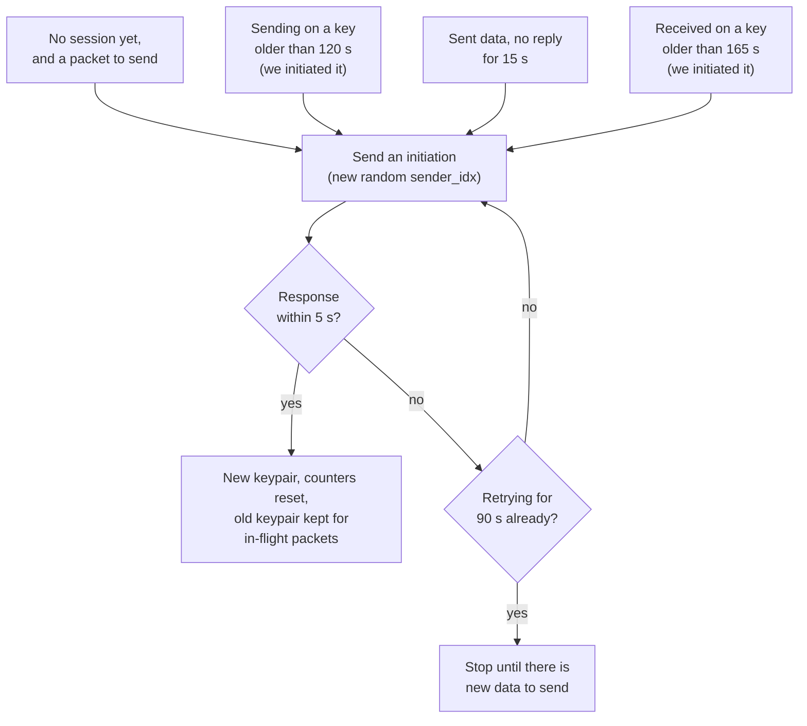

How these numbers show up in the relay:

- The **2-minute rekey** is why the relay keeps learning new indexes, and why old session entries simply age out.
- The relay's **200 s session TTL** sits just above `REJECT_AFTER_TIME`, so the relay never forgets an index that WireGuard might still use.
- The **15 s no-reply rule** is why a client that changes network recovers in about 5 to 15 s ([section 14](#14-when-things-move-roaming-and-restarts)).
- **`PersistentKeepalive = 25`** keeps every NAT mapping open, refreshes the server's registration well inside its 180 s TTL, and, because a keepalive counts as sending, keeps sessions rekeying while idle.

### 3.5 Under load: cookies and mac2

A handshake costs the responder several Curve25519 operations, so a flood of initiations could exhaust it. mac1 already filters anyone who doesn't know the responder's public key. For floods from people who do, WireGuard adds a **cookie** exchange that proves the sender can receive packets at the address it claims:


The cookie reply is encrypted with a key derived from the responder's public key, and its associated data is the mac1 of the message it answers. Only someone who sent that initiation can use it, and a spoofed source address never receives it. That is why the relay lets cookie replies through on *pending* sessions ([section 7](#7-sessions-the-state-machine)): without that, a server under load could never complete a handshake through the relay.

**What the relay changes here.** The server sees every packet arriving from the relay's address, so it computes the same cookie for every client. The cookie no longer proves anything about the real sender. Someone who obtains one cookie through the relay could attach a valid mac2 to initiations sent from spoofed addresses, and the server would do the expensive work for each. The relay's per-source-IP rate limit is then the only brake, and each spoofed address gets its own budget. This is listed under the README's limitations. Possible hardening, not implemented: a global initiation cap per server, or the relay running the cookie exchange itself (it knows each server's public key, which is all the protocol needs).

### 3.6 Cryptokey routing and roaming

Each peer's `AllowedIPs` does two jobs at once:

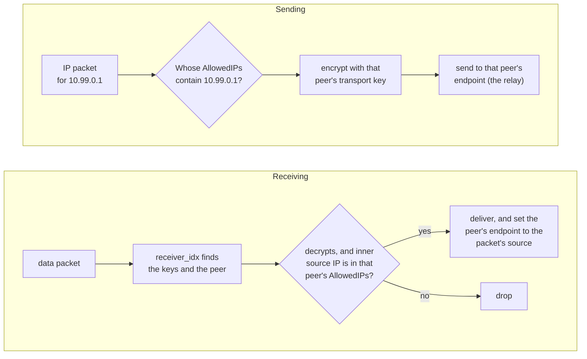

- **Routing out:** the destination IP picks the peer.
- **Filtering in:** a decrypted packet is accepted only if its inner source IP belongs to the peer whose keys decrypted it. A peer cannot spoof another peer's tunnel address.
- **Roaming:** every authenticated packet updates that peer's endpoint to the packet's source. Peers can move freely, and the most recent address wins.

What this means behind the relay:

- Every peer's endpoint is the relay, so from WireGuard's point of view nothing ever roams. The relay absorbs all address changes (section 14).
- The server's `[Peer]` for the relay has `AllowedIPs = 10.99.0.254/32`. Even an attacker holding the relay's private key can only inject packets whose inner source is `10.99.0.254`, and only the relay's pings are routed there. The relay's key opens a door into one `/32` and nothing else.

### 3.7 What survives the relay

| Property | How WireGuard provides it | Through wg-relay |
|---|---|---|
| Confidentiality and integrity | ChaCha20-Poly1305 on every field and packet | unchanged: the relay cannot read or alter anything |
| Mutual authentication | static keys inside Noise IK | unchanged: the relay never holds client or server keys |
| Forward secrecy | ephemeral Diffie-Hellman, keys replaced every 2 min | unchanged |
| Replay protection | handshake timestamps, data counters | unchanged |
| Silence towards strangers | no reply without a valid mac1 and handshake | kept: the relay never answers forwarded traffic |
| Identity hiding | initiator's static key encrypted to the responder | partly lost: mac1 tells the relay which server is called, and the response's mac1 which *listed* client was accepted |
| Flood resistance | mac1, plus cookies bound to the sender's address | weakened: the server sees one address, so cookies stop distinguishing clients (section 3.5) |
| Hidden packet sizes | padding to 16 bytes | unchanged; the relay sees padded sizes and timing |

## 4. The relay's state

The relay is a single-threaded state machine (`Relay` in `src/relay/mod.rs`). `Relay::handle(src, datagram, now)` does no I/O: it returns a verdict, and the socket loop in `src/app.rs` acts on it.

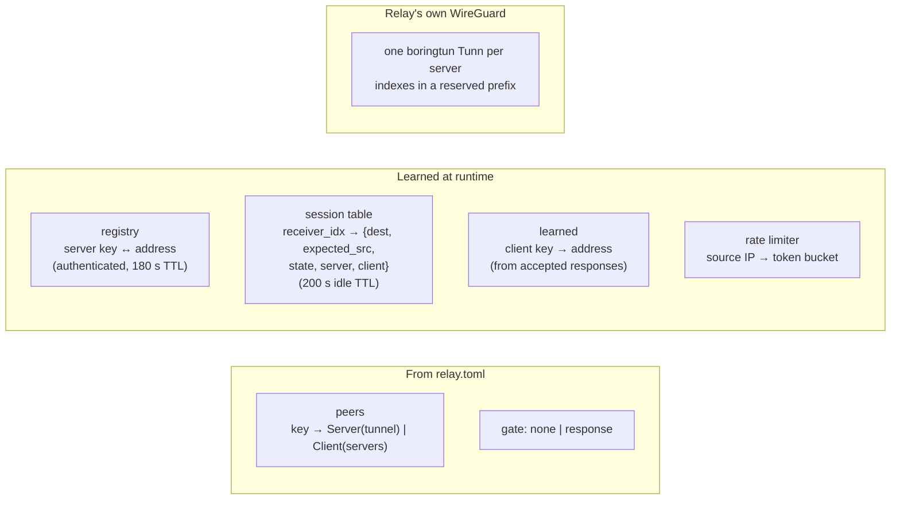

| Table | Written when | Read when | Expires |
|---|---|---|---|
| `registry` | a packet **authenticates** on a server's relay tunnel | finding a server's address; checking a packet came from a server | 180 s without authenticated traffic |
| `sessions` | a handshake is forwarded (pending) or accepted (open) | every type 2, 3 and 4 packet | 200 s without traffic on that index |
| `learned` | a server's response is accepted for a listed client | a server starts a handshake to that client | when no live session involves that client |
| `rate limiter` | every initiation | every initiation | when the bucket would be full again |

The relay never trusts an address it hasn't either authenticated (servers) or seen in a handshake it forwarded (clients).

## 5. Server registration

The relay is an ordinary WireGuard peer of each server, with its own key pair and a `/32` tunnel address (`10.99.0.254`). This tunnel carries no user traffic; it exists so the relay learns, **with cryptographic proof**, where each server is right now.

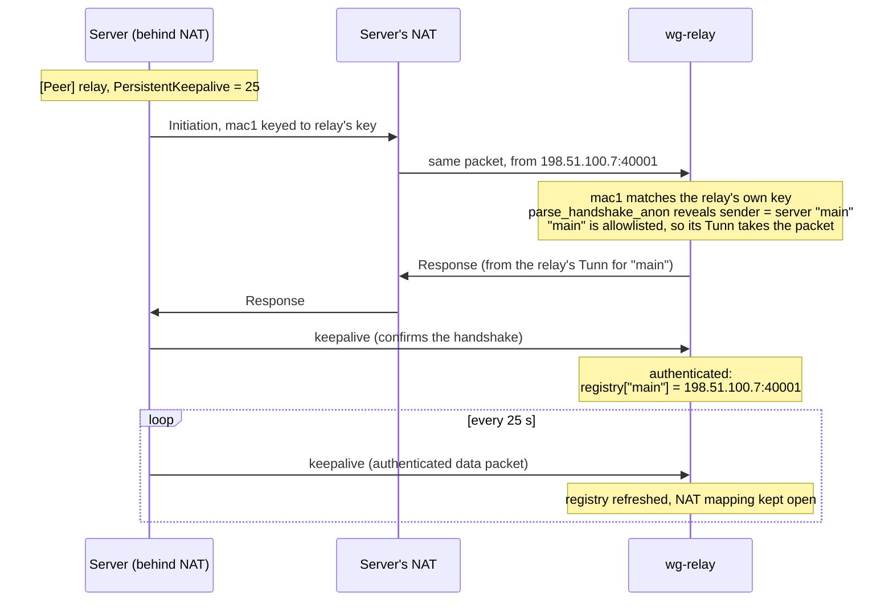

What counts as authenticated: a data packet or a keepalive that decrypts on that server's tunnel. An initiation alone does not count, because a captured one could be replayed from another address (for instance after a relay restart, when the replay timestamp is forgotten); the server's first keepalive right after the handshake does. A cookie reply never counts either, because producing one proves nothing about who you are. If an authenticated packet arrives from a **new** address (the server's NAT rebound), the registry moves the server there and every session using the old address is rewritten.

Registration is refused for keys that aren't allowlisted (`registration_unknown_key`) and for client keys (`client_registration_refused`): clients never talk to the relay directly.

The relay also answers pings to its tunnel IP, so `ping 10.99.0.254` from the server is a one-line registration check.

## 6. A client connects

The client's config just lists the server with `Endpoint = relay:51820`. Here is a full connection in `response` mode, with what the relay records at each step. The client's NAT gives it the public address `C`; the server is registered at `S`.

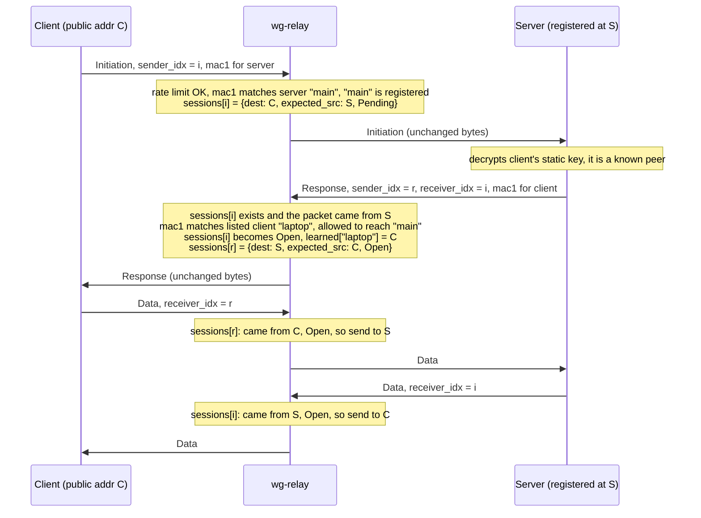

After the handshake there are two session entries, one per direction. Each one says where packets with that index go **and the only address allowed to send them**. That second field is what stops anyone else from injecting packets into the session, even if they guess the index.

## 7. Sessions: the state machine

Every entry in the session table follows this life cycle:

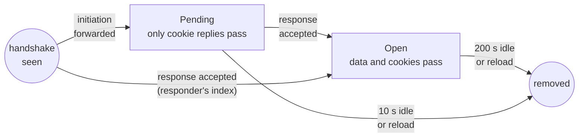

What each state lets through, always only from `expected_src`:

| Packet | `Pending` | `Open` |
|---|---|---|
| Type 2, response | yes, subject to the gate (section 9) | **no** (`session_not_pending`): one response per initiation |
| Type 3, cookie reply | **yes**, so a server under load can still answer | yes |
| Type 4, data | **no** (`session_not_open`) | yes |

A WireGuard session rekeys every 2 minutes, which creates new indexes; the old entries simply age out after 200 s of silence. A pending entry whose handshake is never answered goes after 10 s. If a handshake picks an index that a live entry of a different address pair already holds (probability 2⁻³² per pair by accident), it is dropped (`index_in_use`) and the peer retries with a new index, so an index in use can never be taken over.

## 8. Server-initiated handshakes and rekeys

Sometimes the server starts the handshake: when its session with a client has expired and it has data to send, or right after it restarts. Its initiation's mac1 is keyed to the **client's** public key, so the relay can only route it if that client is listed in `relay.toml` and the relay has seen where it lives.

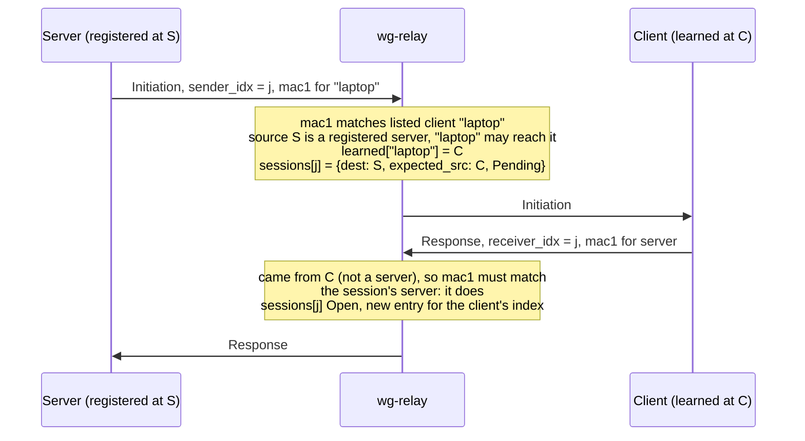

If the client isn't listed, no key matches the mac1 and the packet is dropped (`no_mac1_match`); if it is listed but has never completed a handshake through this relay, its address is unknown (`client_addr_unknown`). In practice this is rare: clients normally initiate, and `PersistentKeepalive` keeps their sessions fresh. It mostly shows up for a few seconds after the server restarts.

## 9. Client gates: `none` vs `response`

Both modes treat initiations the same way: anyone may send one to a registered server, subject to the per-IP rate limit. The server's own WireGuard then decides whether it knows that client. The modes differ in what the relay does with the server's **response**:

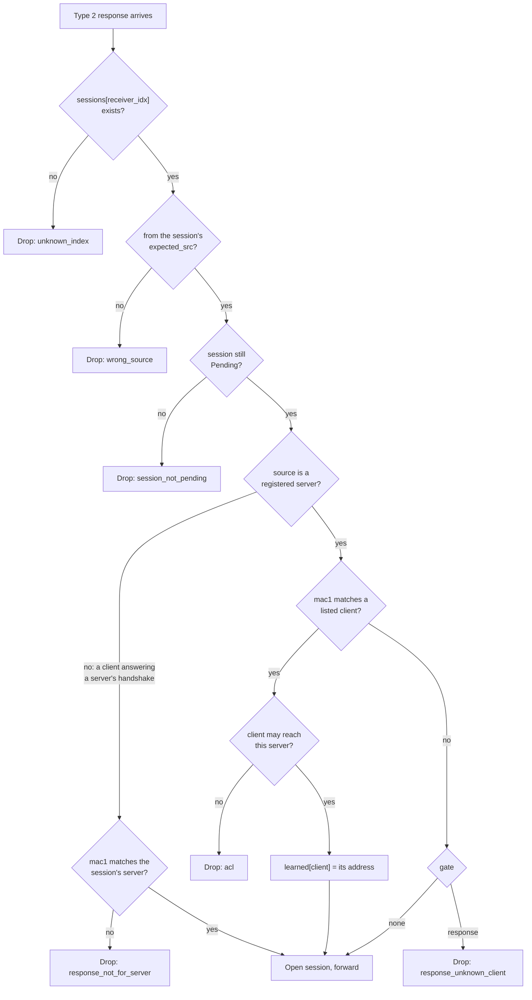

| | `none` | `response` |
|---|---|---|
| `relay.toml` lists | servers (clients optional) | servers **and** clients |
| Who decides access | the server's peer list only | the server's peer list **and** the relay's client list |
| Revoking a client | remove it from the server | remove it from `relay.toml` + SIGHUP (instant), or from the server |
| Server-initiated handshakes | only to listed clients | to every listed client |
| Strangers' initiations | reach the server, which drops them | reach the server, which drops them; the relay would also refuse the session |

In `response` mode the relay is a second, independent gate: a client the server still accepts can be cut off from the relay alone, without touching the server.

## 10. The dispatcher, step by step

Every datagram goes through `Relay::route` (`src/relay/mod.rs`). The checks are ordered from cheapest to most expensive, so junk is rejected before any cryptography happens.

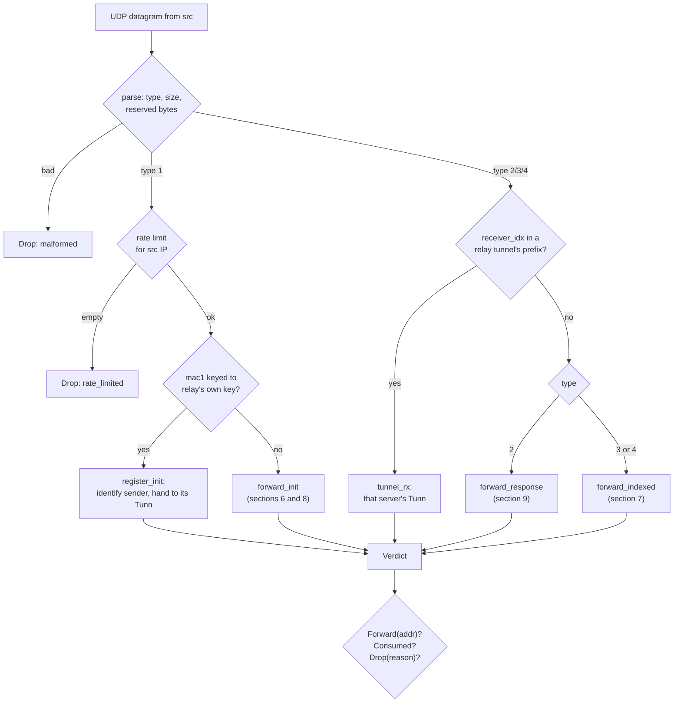

Each forwarding rule returns `Result<SocketAddr, Reason>`; `handle()` turns that into a `Verdict`, counts it, and logs drops at debug level with their reason. The socket loop sends `Forward` datagrams unchanged and drains the relay tunnels' own output (handshake responses, keepalives, ping replies) after every event.

The initiation rule in full:

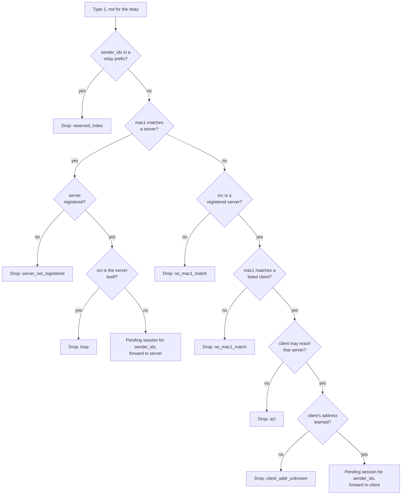

## 11. Index space: relay indexes vs forwarded indexes

The relay's own tunnels need session indexes too, and they share the `receiver_idx` field with forwarded traffic. If a forwarded session ever used an index the relay owns, the relay would swallow its packets. So the space is split:

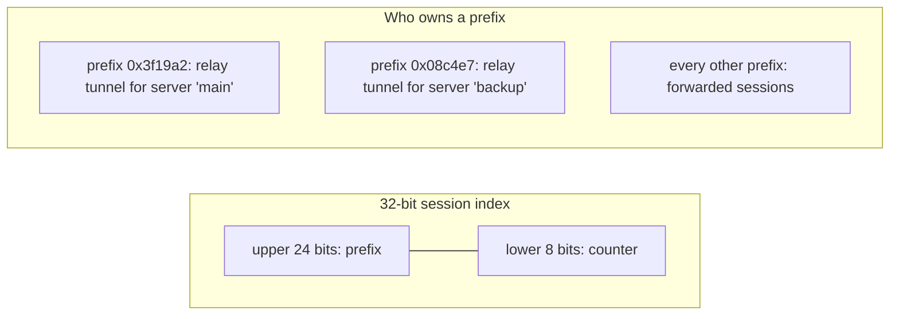

- boringtun numbers a tunnel's sessions `prefix << 8 | counter`, so each relay tunnel uses at most 256 indexes, all under one prefix.
- Each server's tunnel gets a **random** prefix that no live forwarded session is using at the time it is created.
- A forwarded handshake whose `sender_idx` falls inside a relay prefix is dropped (`reserved_index`). WireGuard simply retries with a new random index.

Together these guarantee the two kinds of index never collide, and a packet whose `receiver_idx` is in a relay prefix can go straight to that relay tunnel.

## 12. Timers and expiry

| Timer | Value | Where | Purpose |
|---|---|---|---|
| Peer keepalive | 25 s | node configs (`PersistentKeepalive`) | keeps NAT mappings open, refreshes the server's registration |
| WireGuard rekey | about 2 min | WireGuard itself | new keys and new indexes |
| Registration TTL | 180 s | `REGISTRY_TTL` | a server silent for 3 min is forgotten |
| Session TTL | 200 s idle | `SESSION_TTL` | indexes from old handshakes age out |
| Pending TTL | 10 s idle | `PENDING_TTL` | unanswered initiations do not pile up |
| Relay tick | 250 ms | `app.rs` | runs relay tunnel timers |
| Table sweep | 1 s | `SWEEP_INTERVAL` | expires tables, prunes rate-limit buckets |
| Stats log | 60 s | `app.rs` | logs all counters, including per-reason rejects |
| Rate limit | `handshake_rate_per_ip`, burst 2 s worth | `relay.toml` | caps initiations per source IP |

The values nest deliberately: a healthy server refreshes its registration about seven times per TTL, and a session that is still in use is refreshed on every packet, long before 200 s, while one replaced by a rekey disappears soon after.

```mermaid
gantt
    title One server and one client over five minutes (relative seconds)
    dateFormat X
    axisFormat %s
    section Server
    registered, keepalive every 25 s     :0, 300
    section Session 1
    traffic                              :done, 0, 120
    idle until expiry at 320 s           :120, 300
    section Session 2
    traffic                              :done, 120, 240
    idle                                 :240, 300
    section Session 3
    traffic                              :done, 240, 300
```

## 13. Reload (SIGHUP)

`kill -HUP` re-reads `relay.toml`. If the file is invalid, the running config stays and an error is logged. Changes to `listen` or `private_key` need a restart; everything else applies at once:

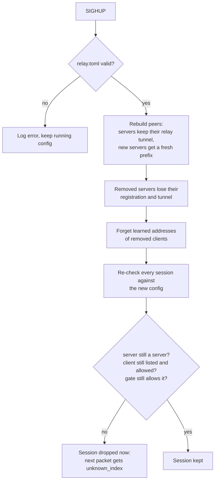

Revocation is immediate, not "at the next rekey": a removed client's very next packet is rejected. Switching from `none` to `response` drops open sessions whose client was never identified, i.e. unlisted clients.

## 14. When things move: roaming and restarts

**A server's NAT rebinds.** Its next keepalive to the relay authenticates from the new address; the registry moves it and every session entry is rewritten. Until then (at most one keepalive interval, 25 s) traffic in both directions is lost: client packets go to the old address, and the server's packets arrive from an address no session expects.

**A client changes network** (Wi-Fi to cellular). Its packets now come from a new address that no session expects, so they are dropped. WireGuard notices it is getting no replies and starts a fresh handshake, which then works normally:

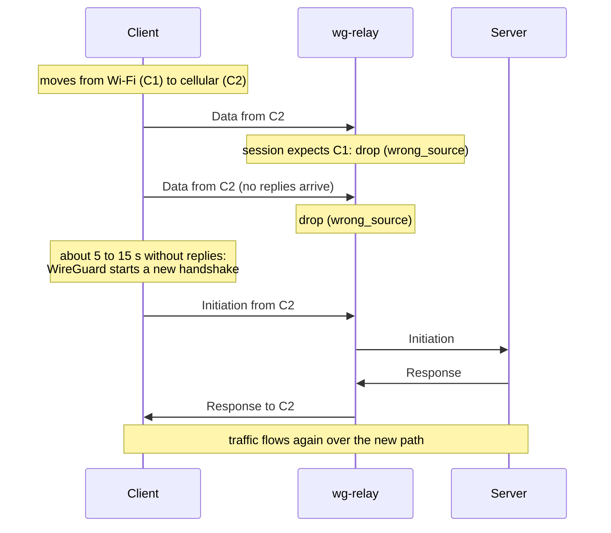

The relay can't follow the client sooner because the client never authenticates to the relay; accepting its new address on its word would let anyone hijack sessions.

**The server restarts.** It re-registers within seconds (its first packet to the relay is a handshake). Client sessions are gone on the server side; clients' next data gets no reply and they re-handshake as above. Server-initiated handshakes reach only listed clients ([section 8](#8-server-initiated-handshakes-and-rekeys)).

## 15. Security model

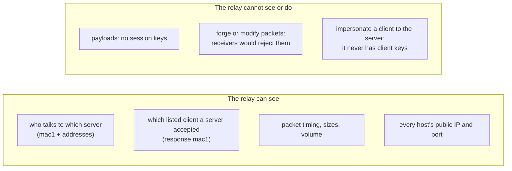

**What stops abuse:**

| Threat | Defence |
|---|---|
| Using the relay as a reflector or amplifier | It only sends to authenticated server addresses or addresses from a handshake it forwarded; replies are never larger than requests; forwarded traffic never triggers relay-generated replies |
| Strangers reaching a server | The server's peer list drops them; in `response` mode the relay also refuses to open their sessions |
| Injecting packets into someone's session | Every non-handshake packet must come from the session's `expected_src` |
| Redirecting a server's traffic | Registration requires a full WireGuard handshake with the server's key; replays fail WireGuard's timestamp and counter checks |
| Handshake floods | Per-IP token bucket before any mac1 work or key exchange |
| A revoked client lingering | SIGHUP drops its sessions immediately |

**What the relay's private key is worth to an attacker:** it opens only the registration tunnels, which carry nothing but keepalives and pings to `10.99.0.254/32`. With it, an attacker could pose as the relay to servers, which gains them the same position as an on-path attacker: they can drop traffic, but not read it.

## 16. Code map

```mermaid
flowchart TD
    main["main.rs<br/>parse CLI, logging, report errors"] --> app["app.rs<br/>Cli, socket loop, timers, signals"]
    app --> cfg["config/<br/>relay.toml, Rate, Summary, ConfigError"]
    app --> relay["relay/mod.rs<br/>Relay, handle, route, tick"]
    relay --> fwd["relay/forward.rs<br/>forward_init, forward_response,<br/>forward_indexed"]
    relay --> regm["relay/registration.rs<br/>register_init, tunnel_rx, ICMP"]
    relay --> rel["relay/reload.rs<br/>reload, session_allowed"]
    relay --> rsn["relay/reason.rs + metrics.rs<br/>Reason, Verdict, counters"]
    relay --> tbl["tables.rs<br/>Registry, SessionTable, RateLimiter"]
    fwd --> pkt["packet/<br/>parse, mac1, SessionIdx"]
    regm --> bt["boringtun Tunn<br/>(relay's own WireGuard)"]
    cfg --> key["key/<br/>PeerKey, PrivateKey"]
```

Following one data packet through the code:

1. `app.rs` `serve()` receives it with `recv_from` and calls `relay.handle(src, bytes, now)`.
2. `handle()` calls `route()`, which calls `packet::parse()` and gets `Packet::Data { receiver }`.
3. `relay_tunnel(receiver)` finds no relay prefix, so `forward_indexed()` looks up `sessions.get(receiver)`, checks `expected_src` and the state, and refreshes `last_seen`.
4. It returns `Ok(dest)`; `handle()` records `Verdict::Forward(dest)` in the metrics.
5. `serve()` calls `send_to(bytes, dest)` with the original, unmodified bytes.

## 17. How it is tested

| Layer | What | Where |
|---|---|---|
| Unit | session table, registry, rate limiter, `Rate` parsing, ICMP reply | `#[cfg(test)]` modules in `src/` |
| Packet | parsing, size checks, mac1 matching on real packets made by boringtun | `tests/packet.rs` |
| Config | defaults, exact `ConfigError` for each bad input, warnings, `--check-config` | `tests/config.rs` |
| Relay, in-process | full handshakes between boringtun peers through `Relay::handle` for both gates, reload, roaming, reserved indexes, rate limits, 20 000 mutated packets | `tests/relay.rs` |
| End-to-end | real kernel WireGuard in network namespaces behind real NATs | `tests/netns.sh` |

The end-to-end topology:

```mermaid
flowchart LR
    subgraph relayns["relay namespace"]
        BR["br0 192.0.2.1<br/>wg-relay :51820<br/>tcpdump"]
    end
    subgraph s["server side"]
        SRV["srv<br/>wg0 10.99.0.1"] --- NS["natsrv<br/>MASQUERADE"]
    end
    subgraph c1s["client 1"]
        C1["c1<br/>wg0 10.99.0.11"] --- N1["natc1"]
    end
    subgraph c2s["client 2"]
        C2["c2<br/>wg0 10.99.0.12"] --- N2["natc2"]
    end
    subgraph sts["stranger"]
        ST["st<br/>wg0 10.99.0.13"] --- N3["natst"]
    end
    NS --- BR
    N1 --- BR
    N2 --- BR
    N3 --- BR
```

It runs once per gate and checks that clients reach the server, the stranger doesn't, rekeys in both directions work, SIGHUP revokes instantly, and, from a packet capture at the relay, that forwarded handshakes cannot be opened with the relay's key, every forwarded packet is byte-identical, and the ping payload never appears on the wire.
